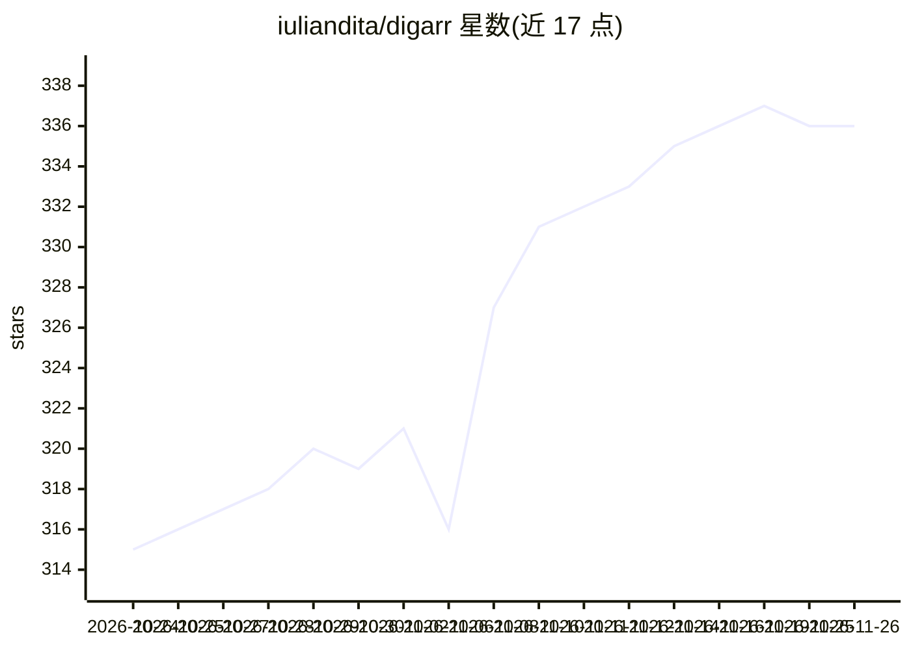

# iuliandita/digarr

⭐ 336 · TypeScript · MIT · 推送 2026-11-25 · [GitHub](https://github.com/iuliandita/digarr) · [官网](https://github.com/iuliandita/digarr#readme) · 个人维护

**自托管音乐发现工具：从听歌记录找艺人专辑并推送**

自托管的音乐发现 Web 应用：连接 ListenBrainz/Last.fm/Spotify/Plex 等收听来源，扫描后生成带评分的艺人/专辑推荐，用户预览、批准或拒绝后可发送至 Lidarr、slskd 或导出为 Spotify/媒体服务器播放列表。AI 部分由用户自选提供商或本地模型驱动推荐（Anthropic/OpenAI/Gemini/Ollama/OpenAI 兼容端点）。不含下载器与完整播放器，Lidarr 为可选；支持多用户隔离、OIDC/SSO、15 种语言，凭据加密依赖 DIGARR_ENCRYPTION_KEY。

## 筛选速览

| 维度 | 判定 | 备注 |
|---|---|---|
| AI 角色 | `ai-enhanced` | 去掉 AI 部分产品仍成立 |
| 许可风险 | `permissive` | MIT |
| 部署形态 | `self-host` | docker 或自建部署 |
| 模型依赖 | local-ok | 支持本地模型 |
| 硬件要求 | — | 无带数字的原话,不猜 |
| 安装摩擦 | `low` | 无编译、无系统依赖或容器化 |
| 成熟度 | — | 结构信号不足 |

## 能力要点

- 从收听历史或心情生成评分推荐，支持 Release Radar 与专辑补缺等模式
- AI 提供商可自选：Anthropic、OpenAI、Gemini、Ollama 或 OpenAI 兼容端点
- 单容器运行，内嵌 PGlite 数据库；另提供 Docker Compose/Helm/k8s 部署
- 多用户隔离与审批策略，支持 OIDC/SSO 与 15 种语言

## 适用场景

- 根据听歌记录发现新发行和缺失专辑并加入 Lidarr
- 不用 Lidarr，仅生成并同步 Spotify/媒体服务器播放列表
- 团队共享一个实例，各成员有独立队列与连接

## 场景标签

`推荐系统` · 领域:学习与行业

## 证据(README 行号)

> L11: **Self-hosted music discovery for your library.** Digarr finds artists and albums from your listening history or a 
> L42: |AI recommendations|Anthropic, OpenAI, Gemini, Ollama, OpenAI-compatible endpoints|
> L59: You need Docker and access to an AI provider or local model. Digarr includes an embedded PostgreSQL database (PGlit

## 星数曲线

2026-10-24 315 → 2026-11-26 336（+21）

---
*卡片 v1 · prompt 1.4 · 生成 2026-11-25 · 置信度 high · 依据 README sha `b382e3470c30` · [字段定义](../../DATASET.md)*
