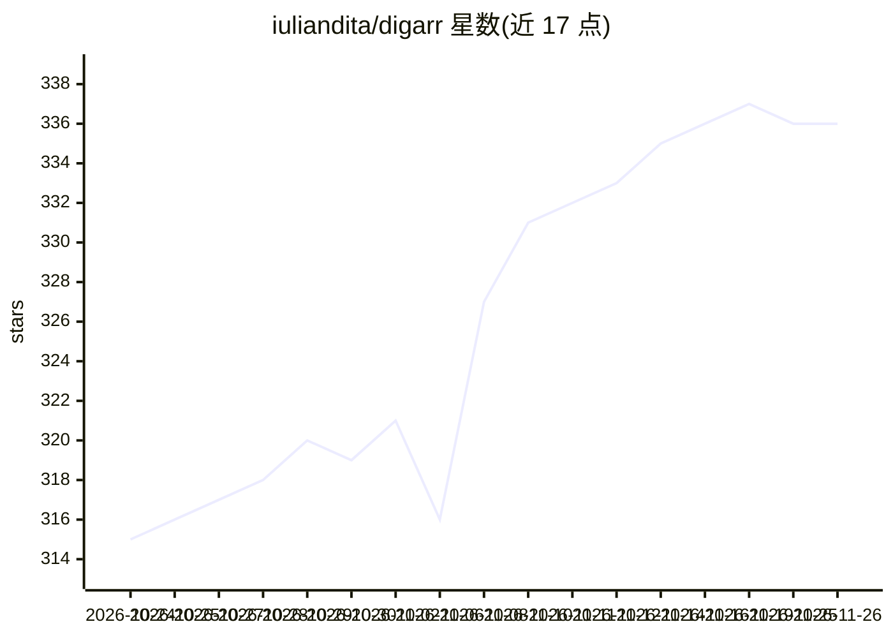

# iuliandita/digarr

⭐ 336 · TypeScript · MIT · 推送 2026-11-25 · [GitHub](https://github.com/iuliandita/digarr) · [官网](https://github.com/iuliandita/digarr#readme) · 个人维护

**自托管音乐发现服务：基于收听历史推荐艺术家与专辑**

自托管的音乐发现应用，读取 ListenBrainz、Last.fm、Spotify、Plex 等收听来源与媒体库，生成带评分的艺术家/专辑建议，用户预览、批准或拒绝后发送到 Lidarr、slskd 或播放列表。AI 建议由用户自选的云端或本地模型提供，可跳过仅依赖收听数据。内嵌 PGlite 数据库单容器运行，支持多用户、OIDC/SSO、15 种语言与调度发现模式。本身不含下载器或播放器。

## 筛选速览

| 维度 | 判定 | 备注 |
|---|---|---|
| AI 角色 | `ai-native` | 本体是模型或模型工具 |
| 许可风险 | `permissive` | MIT |
| 部署形态 | `self-host` | docker 或自建部署 |
| 模型依赖 | local-ok | 支持本地模型 |
| 硬件要求 | — | 无带数字的原话,不猜 |
| 安装摩擦 | `low` | 无编译、无系统依赖或容器化 |
| 成熟度 | — | 结构信号不足 |

## 能力要点

- 从收听历史或心情搜索生成评分建议，含 Release Radar 与曲库缺口补全模式
- 支持 Anthropic、OpenAI、Gemini、Ollama 及 OpenAI 兼容端点作为推荐来源
- 批准后发送到 Lidarr、slskd 或导出 Spotify/Navidrome 等播放列表（M3U/XSPF）
- 内嵌 PGlite 数据库，Docker 单容器运行，支持多用户与 OIDC/SSO

## 适用场景

- 根据我的收听历史发现要补齐的艺术家和专辑
- 审查 AI 推荐后一键发送到 Lidarr 下载
- 从我的媒体库生成可刷新的播放列表
- 与家人共享实例并各自管理队列与偏好

## 场景标签

`推荐系统` · 领域:学习与行业

## 证据(README 行号)

> L11: **Self-hosted music discovery for your library.** Digarr finds artists and albums from your listening history or a 
> L22: - **Find artists and albums.** Connect a listening source, scan, and review scored suggestions. Release Radar finds
> L42: |AI recommendations|Anthropic, OpenAI, Gemini, Ollama, OpenAI-compatible endpoints|

## 星数曲线

2026-10-24 315 → 2026-11-26 336（+21）

---
*卡片 v1 · prompt 1.4 · 生成 2026-11-26 · 置信度 high · 依据 README sha `ccda5dd3af9c` · [字段定义](../../DATASET.md)*
