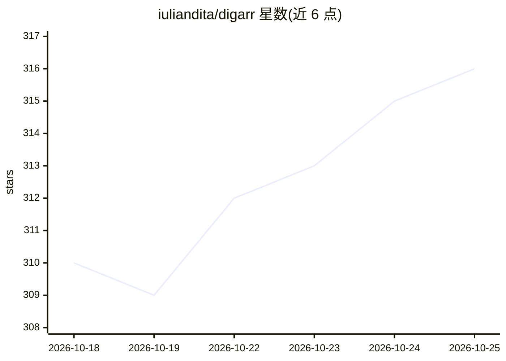

# iuliandita/digarr

⭐ 316 · TypeScript · MIT · 推送 2026-10-24 · [GitHub](https://github.com/iuliandita/digarr) · [官网](https://github.com/iuliandita/digarr#readme) · 个人维护

**自托管音乐发现工具：从收听历史生成推荐并送往 Lidarr 等服务**

Digarr 是面向个人音乐库的自托管发现应用：连接 ListenBrainz、Last.fm、Spotify、Plex、Jellyfin 等收听/媒体服务，扫描后生成带评分的艺术家与专辑建议，可试听、批准或拒绝，再发送到 Lidarr、slskd 或播放列表。AI 推荐支持 Anthropic/OpenAI/Gemini/Ollama 及 OpenAI 兼容端点，也可跳过 AI 仅用收听来源。不含下载器与完整播放器。以 Docker 单容器（内嵌 PGlite）、Compose、Helm 或 k8s 清单部署，支持多用户、OIDC/SSO 与 15 种语言。

## 筛选速览

| 维度 | 判定 | 备注 |
|---|---|---|
| AI 角色 | `ai-enhanced` | 去掉 AI 部分产品仍成立 |
| 许可风险 | `permissive` | MIT |
| 部署形态 | `self-host` | docker 或自建部署 |
| 模型依赖 | local-ok | 支持本地模型 |
| 硬件要求 | — | 无带数字的原话,不猜 |
| 安装摩擦 | `low` | 无编译、无系统依赖或容器化 |
| 成熟度 | — | 结构信号不足 |

## 能力要点

- 连接 ListenBrainz/Last.fm/Spotify/Plex/Jellyfin/Emby 等多种收听与媒体服务
- 建议经预览/批准/拒绝流程后发送 Lidarr、slskd 或播放列表
- AI 推荐支持 Anthropic/OpenAI/Gemini/Ollama 与 OpenAI 兼容端点，也可跳过
- 单容器部署内嵌 PGlite，另提供 Compose、Helm 与 k8s 清单

## 适用场景

- 为自托管音乐库发现新艺术家和缺失专辑
- 把批准的推荐自动推送到 Lidarr 或 slskd
- 从收听历史或心情生成并导出播放列表

## 场景标签

`推荐系统` · 领域:学习与行业

## 证据(README 行号)

> L13: **Self-hosted music discovery for your library.** Digarr finds artists and albums from your listening history or a 
> L82: 1. Sign in, then choose Lidarr, Emby, or discovery-only in the setup wizard and configure your AI provider, or skip

## 星数曲线

2026-10-18 310 → 2026-10-25 316（+6）

---
*卡片 v1 · prompt 1.4 · 生成 2026-10-21 · 置信度 high · 依据 README sha `2c17bc287d3e` · [字段定义](../../DATASET.md)*
