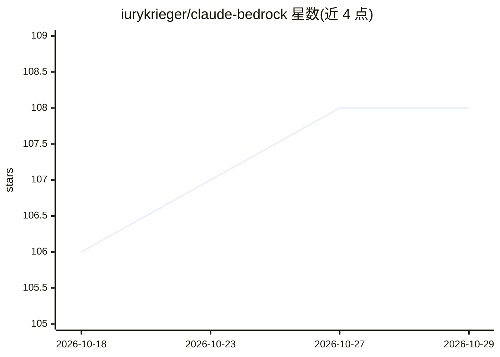

# iurykrieger/claude-bedrock

⭐ 108 · HTML · MIT · 推送 2026-05-05 · [GitHub](https://github.com/iurykrieger/claude-bedrock) · [官网](https://claude-bedrock.vercel.app) · 个人维护

**把 Obsidian 仓库变成 AI 管理的 Second Brain 的 Claude Code 插件**

面向 Obsidian 用户的 Claude Code 插件，提供 8 个 AI 技能（setup/ask/learn/preserve/compress/sync/healthcheck/vaults），将仓库内容组织为 7 种实体类型并自动生成双向 wikilink，形成可用 Obsidian 图谱视图导航的知识图谱。支持从 Confluence、Google Docs、GitHub 仓库及 docling 支持的多种文件格式摄取内容，提供去重、断链修复与外部源重同步。依赖 graphify 与 docling（setup 时自动经 pipx 安装）。自动错误上报默认开启，可通过配置关闭。

## 筛选速览

| 维度 | 判定 | 备注 |
|---|---|---|
| AI 角色 | `ai-native` | 本体是模型或模型工具 |
| 许可风险 | `permissive` | MIT |
| 部署形态 | `None` |  |
| 模型依赖 | — | README 未给出锁定关系 |
| 硬件要求 | — | 无带数字的原话,不猜 |
| 安装摩擦 | `low` | 无编译、无系统依赖或容器化 |
| 成熟度 | — | 结构信号不足 |

## 能力要点

- 8 个 AI 技能覆盖仓库初始化、问答、摄取、压缩、同步与诊断
- 7 种实体类型 + 双向 wikilink，Obsidian 图谱视图可视化
- 外部源摄取：Confluence、Google Docs、GitHub 及 docling 支持的 DOCX/PPTX/XLSX/PDF/HTML/EPUB/图像等格式
- graphify 与 docling 依赖在 setup 或首次使用时自动安装

## 适用场景

- 把现有 Obsidian 仓库整理成结构化知识图谱
- 通过对话询问仓库中的人物、系统与项目状态并获得带引用的回答
- 将 Confluence/Google Docs/GitHub 等外部源持续摄取并同步进知识库
- 对仓库做去重、断链与陈旧内容的健康检查

## 场景标签

`知识库管理` `知识图谱` · 领域:知识与检索

## 证据(README 行号)

> L11: Bedrock is a Claude Code plugin that automates Obsidian vault management through AI-powered skills. It organizes kn
> L60: |`/bedrock:ask`|Orchestrated vault reader — decomposes questions, searches graph and vault, cross-references entiti
> L91: - **Capture knowledge from a source** — paste a Confluence page, Google Doc, GitHub repo, remote URL, or any local 

## 星数曲线

2026-10-18 106 → 2026-10-29 108（+2）

---
*卡片 v1 · prompt 1.4 · 生成 2026-10-23 · 置信度 high · 依据 README sha `e6700516133c` · [字段定义](../../DATASET.md)*
