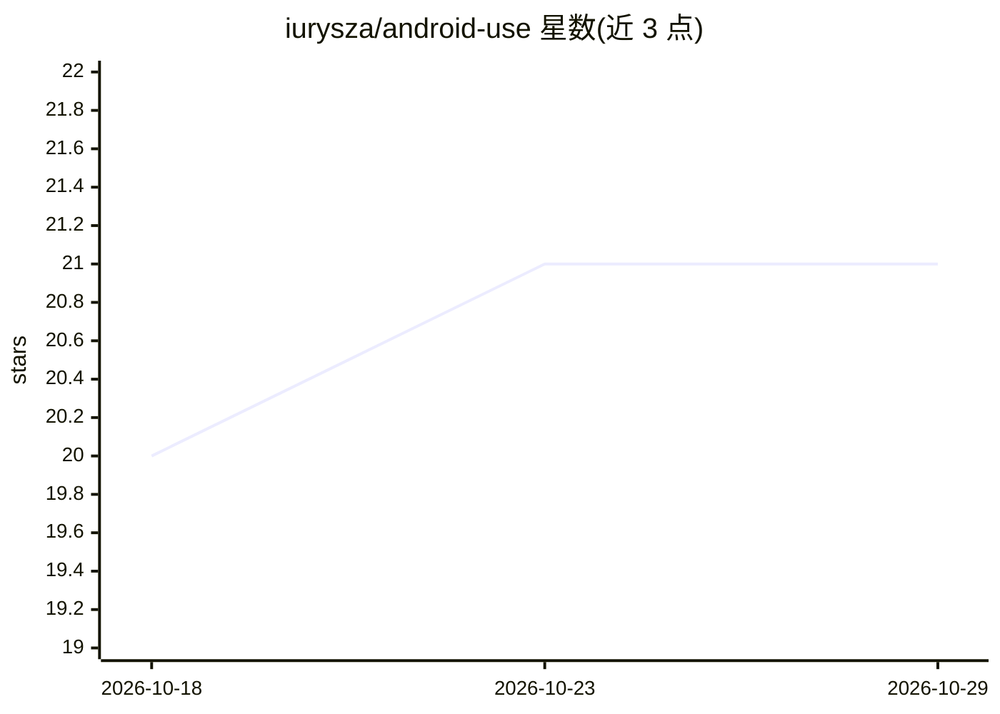

# iurysza/android-use

⭐ 21 · TypeScript · MIT · 推送 2026-10-06 · [GitHub](https://github.com/iurysza/android-use) · [官网](https://github.com/iurysza/android-use) · 个人维护

**ADB 语义封装 CLI，供 agent 结构化操控 Android 设备**

基于 ADB 的 Android 设备自动化命令行工具，提供 tap、swipe、输入文本、启动应用、读取屏幕 UI 等命令。它在 ADB 之上加一层语义封装：返回带校验的结构化 JSON（typed success/failure 结果），屏幕转储压缩为约 50-200 token 的紧凑表示并附带从无障碍树解析的坐标，面向有上下文限制的 LLM agent；采用感知→行动循环模式。同时提供 SKILL 文件供 agent 使用。运行需本机安装 ADB 并开启设备 USB 调试，通过官方 install.sh 脚本安装。

## 筛选速览

| 维度 | 判定 | 备注 |
|---|---|---|
| AI 角色 | `ai-ecosystem` | LLM/agent 周边工具 |
| 许可风险 | `permissive` | MIT |
| 部署形态 | `None` |  |
| 模型依赖 | — | README 未给出锁定关系 |
| 硬件要求 | — | 无带数字的原话,不猜 |
| 安装摩擦 | `low` | 无编译、无系统依赖或容器化 |
| 成熟度 | — | 结构信号不足 |

## 能力要点

- 结构化 JSON 输出与类型化成功/失败结果
- 屏幕转储压缩至约 50-200 token 并解析点击坐标
- 覆盖 tap/type-text/launch-app 等常用设备操作命令
- 提供面向 agent 的 SKILL 文件与上手指南

## 适用场景

- 让 LLM agent 通过结构化命令操控 Android 设备
- 自动化 Android UI 交互与测试流程
- 以低 token 消耗读取设备屏幕状态

## 场景标签

`GUI 自动化` · 领域:效率与自动化

## 证据(README 行号)

> L9: Control Android devices programmatically. Tap, swipe, type, launch apps, and automate UI interactions with structure
> L17: **Why:** Raw ADB outputs unstructured text. This tool returns structured JSON with consistent error handling, scree

## 星数曲线

2026-10-18 20 → 2026-10-29 21（+1）

---
*卡片 v1 · prompt 1.4 · 生成 2026-10-28 · 置信度 high · 依据 README sha `43556d5d978b` · [字段定义](../../DATASET.md)*
