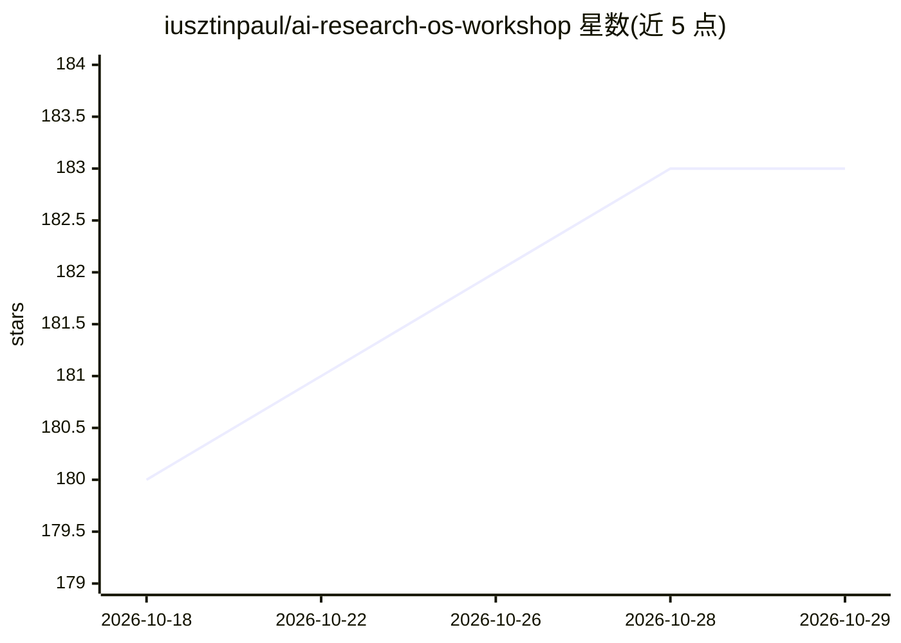

# iusztinpaul/ai-research-os-workshop

⭐ 183 · Python · MIT · 推送 2026-06-27 · [GitHub](https://github.com/iusztinpaul/ai-research-os-workshop) · [官网](https://academy.towardsai.net/courses/agent-engineering?utm_source=github&utm_medium=aieng&utm_campaign=2026_aieng_sf_online) · 个人维护

**给研究者的 Claude Code/Codex 技能包：把第二大脑变成可复用研究记忆**

一套本地运行的 AI agent 技能（/research、/research-distill、/research-lint、/research-render），依附于 Claude Code 或 Codex 之上：从 Obsidian、Readwise、GitHub 仓库、YouTube 字幕、网页、PDF 等来源摄入素材，经深度研究发现轮次后生成带索引与综述的持久化 markdown 研究 wiki，供后续会话查询与追加而非一次性回答。以 Claude Code 插件市场命令或 git clone 拷贝技能目录安装；需 uv 运行辅助脚本，各来源连接 CLI 可选且缺失时降级运行。

## 筛选速览

| 维度 | 判定 | 备注 |
|---|---|---|
| AI 角色 | `ai-ecosystem` | LLM/agent 周边工具 |
| 许可风险 | `permissive` | MIT |
| 部署形态 | `library` | 以包/库形式分发 |
| 模型依赖 | locked-api |  |
| 硬件要求 | — | 无带数字的原话,不猜 |
| 安装摩擦 | `low` | 无编译、无系统依赖或容器化 |
| 成熟度 | — | 结构信号不足 |

## 能力要点

- 四个技能：研究目录初始化/追加/查询、蒸馏、健康检查、渲染为幻灯片/图表
- query 模式按 index→wiki→原始来源逐级下钻以压缩上下文窗口
- 三档深度预设（fast/light/deep）控制来源发现轮次
- 来源连接器缺失时优雅降级，可零额外配置启动

## 适用场景

- 跨多次会话持续研究同一主题并沉淀研究 wiki
- 对比多个代码仓库/论文/视频并生成横向比较页
- 让后续的 Codex/Claude 运行复用先前研究成果而非重新调研

## 场景标签

`科研工具` `Agent 记忆` · 领域:Agent 开发

## 证据(README 行号)

> L36: `AI Research OS` is a set of local AI skills for building and querying a persistent research wiki from your own sou
> L211: 1. **Claude Code** (or Codex) — the agent that runs the skills.

## 星数曲线

2026-10-18 180 → 2026-10-29 183（+3）

---
*卡片 v1 · prompt 1.4 · 生成 2026-10-22 · 置信度 mid · 依据 README sha `ff34d25b27ab` · [字段定义](../../DATASET.md)*
