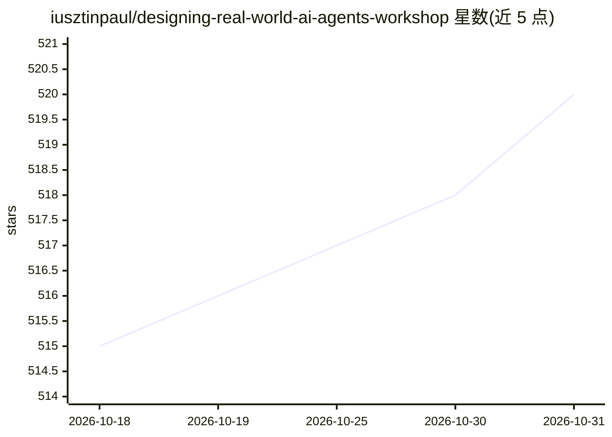

# iusztinpaul/designing-real-world-ai-agents-workshop

⭐ 520 · Python · MIT · 推送 2026-06-03 · [GitHub](https://github.com/iusztinpaul/designing-real-world-ai-agents-workshop) · [官网](https://academy.towardsai.net/courses/agent-engineering?utm_source=github&utm_medium=aieng&utm_campaign=2026_aieng_workshop&utm_id=researchwriter) · 个人维护

**动手工坊：从零构建深度研究+技术写作多智能体系统**

在 AI Engineering Conference Europe 演示的实操工坊仓库，含代码、幻灯片与 2 小时视频。构建两个 MCP 服务器：Deep Research Agent（Gemini + Google Search grounding + YouTube 视频分析，产出 research.md）和 LinkedIn Writing Workflow（评估-优化循环生成帖子并配图）。可接入 Claude Code/Cursor 等 MCP harness，或用 Streamlit UI、技能命令、脚本运行。仓库另含 25 张工单的自实现骨架供从零复刻，需 Python 3.12+、uv 与 Google API Key。

## 筛选速览

| 维度 | 判定 | 备注 |
|---|---|---|
| AI 角色 | `ai-knowledge` | 知识聚合/清单类 |
| 许可风险 | `permissive` | MIT |
| 部署形态 | `None` |  |
| 模型依赖 | — | README 未给出锁定关系 |
| 硬件要求 | — | 无带数字的原话,不猜 |
| 安装摩擦 | `low` | 无编译、无系统依赖或容器化 |
| 成熟度 | — | 结构信号不足 |

## 能力要点

- Deep Research Agent MCP 服务器：Gemini grounding 搜索 + YouTube 视频分析 + 研究简报编译
- Writing Workflow：生成-审阅-编辑循环产出 LinkedIn 帖子并生成配图
- 四种运行方式：MCP 服务器、斜杠命令技能、Streamlit UI、终端脚本
- 自实现骨架：25 张预备工单 + 自定义 /implement 技能，从零 1:1 复刻（约 2–4 小时）

## 适用场景

- 跟着视频和代码学习 tool-use agents、评估-优化循环与 MCP 服务器设计
- 把深度研究与写作工作流接入 Claude Code/Cursor 交互使用
- 通过 25 张工单的骨架练习 agentic coding 自行实现整套系统

## 场景标签

`教程课程` `多智能体` · 领域:Agent 开发

## 证据(README 行号)

> L3: A hands-on workshop, presented at AI Engineering Conference Europe, building a multi-agent AI system with two MCP se
> L29: 1. **Watch the workshop and see the patterns end-to-end. Watch in ~2 hr.** Start with the 2-hour YouTube workshop a
> L31: 3. **Implement it yourself with agentic coding. Build a 1:1 replica from scratch in ~2–4 hr.** Open `implement_your

## 星数曲线

2026-10-18 515 → 2026-10-31 520（+5）

---
*卡片 v1 · prompt 1.4 · 生成 2026-10-21 · 置信度 high · 依据 README sha `5863d0b3a4f6` · [字段定义](../../DATASET.md)*
