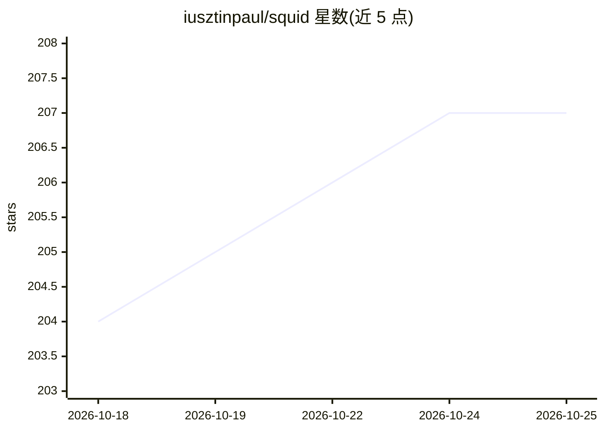

# iusztinpaul/squid

⭐ 207 · Python · Apache-2.0 · 推送 2026-10-14 · [GitHub](https://github.com/iusztinpaul/squid) · 个人维护

**Claude Code 插件：以 5-agent 流水线把功能规格变成已评审 PR**

面向 Claude Code 的插件，将功能规格经 PA→SWE→Tester→PR Reviewer→On-Call 五个 sub-agent 流水线转化为经过评审的 PR，仅保留计划批准与最终合并两处人工关卡。提供 /squid-scaffold、/squid-plan、/squid-implement-night 等命令与技能，每个 agent 固定模型与 effort 配置（fable/opus/sonnet）。覆盖 Python 后端、TypeScript 前端、Go TUI 栈；可选集成 caveman 插件压缩输出。通过 Claude Code 插件市场安装，或用 npx skills 单独安装技能（不含 sub-agent 与 MCP 插件，完整流水线需插件安装路径）。

## 筛选速览

| 维度 | 判定 | 备注 |
|---|---|---|
| AI 角色 | `ai-ecosystem` | LLM/agent 周边工具 |
| 许可风险 | `permissive` | Apache-2.0 |
| 部署形态 | `library` | 以包/库形式分发 |
| 模型依赖 | — | README 未给出锁定关系 |
| 硬件要求 | — | 无带数字的原话,不猜 |
| 安装摩擦 | `low` | 无编译、无系统依赖或容器化 |
| 成熟度 | — | 结构信号不足 |

## 能力要点

- 5-agent 流水线（PA/SWE/Tester/PR Reviewer/On-Call）与两处人工关卡
- 每个 agent 按角色固定模型与 effort 配置（fable/opus/sonnet）
- 跨 agent 的 npx skills CLI 可单独安装技能（兼容 Cursor、Codex 等 70+ agent）
- 可选集成 caveman 插件压缩提交、评审与记忆文件

## 适用场景

- 个人开发者或小团队用 Claude Code 按团队规范持续交付功能
- 从空仓库引导生成 AGENTS.md、目录骨架与规范索引
- 只取 Squid 的部分技能嵌入 Cursor/Codex 等其他 agent 使用

## 场景标签

`编码 Agent` `多智能体` · 领域:Agent 开发

## 证据(README 行号)

> L11: **Squid is a Claude Code plugin that turns a feature spec into a reviewed PR through a 5-agent pipeline — PA → SWE 
> L130: |`product-architect`, `software-engineer`, `tester`, `pr-reviewer`, `oncall-engineer`|Sub-agents invoked by the pi

## 星数曲线

2026-10-18 204 → 2026-10-25 207（+3）

---
*卡片 v1 · prompt 1.4 · 生成 2026-10-22 · 置信度 high · 依据 README sha `1533770bc6a9` · [字段定义](../../DATASET.md)*
