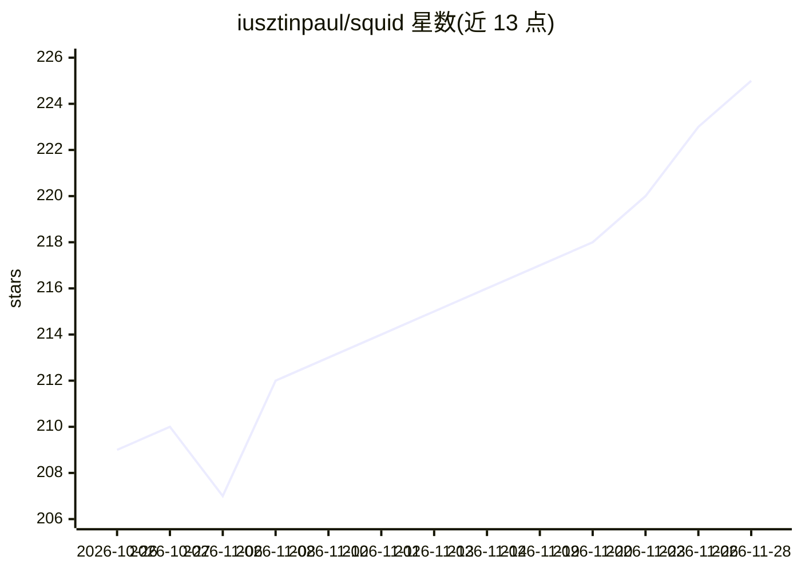

# iusztinpaul/squid

⭐ 225 · Python · Apache-2.0 · 推送 2026-11-17 · [GitHub](https://github.com/iusztinpaul/squid) · 个人维护

**Claude Code 插件：把 feature spec 经五 agent 流水线变成已审查 PR**

Squid 是一个 Claude Code 插件，通过 PA→SWE→Tester→PR Reviewer→On-Call 五个 agent 流水线，将 feature spec 推进到经过审查的 PR，仅在计划批准与最终合并两处设人工关卡。提供 /squid-plan、/squid-implement-night 等命令与可单独调用的 sub-agent，每个 agent 绑定固定模型与 effort 配置，可在 agent 文件的 frontmatter 中覆写。定位面向使用 Python 后端、TypeScript 前端、Go TUI 的个人开发者与小团队；不含 Rust、Java、移动端。支持 Claude Code marketplace 安装或 npx skills 单独安装技能（后者不含 sub-agent 与 MCP 插件）。

## 筛选速览

| 维度 | 判定 | 备注 |
|---|---|---|
| AI 角色 | `ai-ecosystem` | LLM/agent 周边工具 |
| 许可风险 | `permissive` | Apache-2.0 |
| 部署形态 | `library` | 以包/库形式分发 |
| 模型依赖 | — | README 未给出锁定关系 |
| 硬件要求 | — | 无带数字的原话,不猜 |
| 安装摩擦 | `low` | 无编译、无系统依赖或容器化 |
| 成熟度 | — | 结构信号不足 |

## 能力要点

- 五 agent 流水线，仅两个人工关卡：计划批准与最终合并
- 每个 agent 固定模型与 effort 配置，可通过 frontmatter 修改
- npx skills 可将技能安装到 Claude Code、Cursor 等 70+ agent
- /squid-scaffold 从空仓库生成 AGENTS.md、目录骨架与可选 docker-compose/CI 配置

## 适用场景

- 让 Claude Code 按团队约定一致地产出代码、测试并通过审查
- 小团队从空仓库脚手架到 PR 的端到端单特性流水线
- 在 Cursor 等其他 agent 中单独复用 Squid 的技能

## 场景标签

`编码 Agent` · 领域:编码与开发

## 证据(README 行号)

> L11: **Squid is a Claude Code plugin that turns a feature spec into a reviewed PR through a 5-agent pipeline — PA → SWE 
> L28: - **Yes:** solo devs and small teams shipping Python backends, TypeScript frontends, or Go TUIs who want Claude Cod

## 星数曲线

2026-10-26 209 → 2026-11-28 225（+16）

---
*卡片 v1 · prompt 1.4 · 生成 2026-11-25 · 置信度 high · 依据 README sha `1466a5a7fcdd` · [字段定义](../../DATASET.md)*
