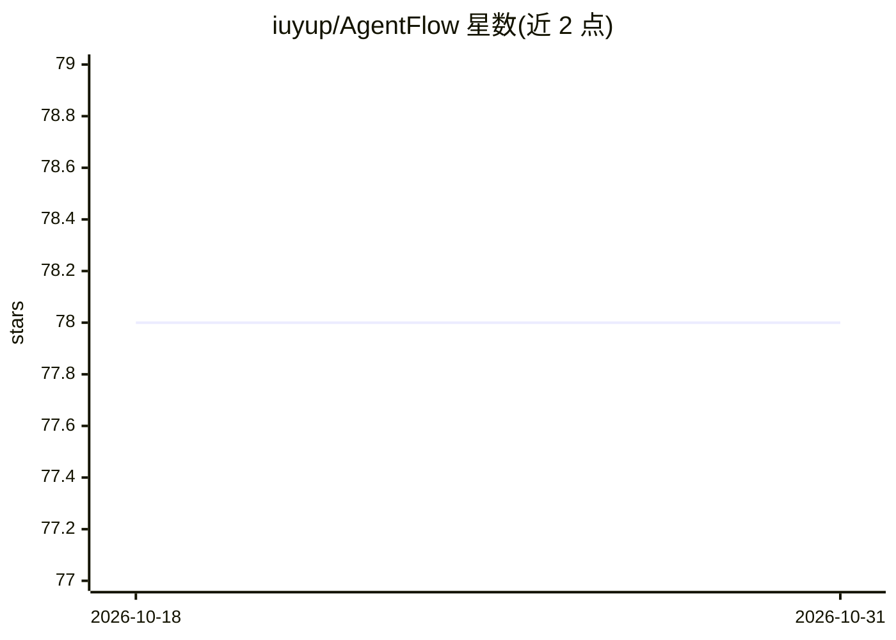

# iuyup/AgentFlow

⭐ 78 · Python · MIT · 推送 2026-04-09 · [GitHub](https://github.com/iuyup/AgentFlow) · [官网](https://iuyup.github.io/AgentFlow/) · 个人维护 · 中文 README

**基于 LangGraph 的多智能体协作设计模式参考集（10+ 模式）**

由个人维护的多智能体设计模式参考库：基于 LangGraph 提供 11 种模式（Reflection、Debate、MapReduce、Hierarchical、Voting、GuardRail、RAG-Agent、Chain-of-Experts、Human-in-the-Loop、Swarm、Self-Improving），每个模式含可运行代码、架构图与用例分析，自称“设计模式参考书”而非框架。默认依赖 OpenAI API key（gpt-4o-mini），Python 3.11+，uv 安装，附 MkDocs 文档站与单元/集成测试；单元测试无需 API key。

## 筛选速览

| 维度 | 判定 | 备注 |
|---|---|---|
| AI 角色 | `ai-knowledge` | 知识聚合/清单类 |
| 许可风险 | `permissive` | MIT |
| 部署形态 | `library` | 以包/库形式分发 |
| 模型依赖 | — | README 未给出锁定关系 |
| 硬件要求 | — | 无带数字的原话,不猜 |
| 安装摩擦 | `low` | 无编译、无系统依赖或容器化 |
| 成熟度 | — | 结构信号不足 |

## 能力要点

- 11 种 LangGraph 多智能体模式，每个含可运行完整代码
- 每模式附架构图、用例分析与性能对比
- 单元测试无需 API key，集成测试需 OPENAI_API_KEY
- 英文+中文双语 README 与文档站

## 适用场景

- 学习多智能体系统的架构决策与模式选择
- 复制并改造现成模式到自己的 LangGraph 项目
- 对比不同协作模式的性能表现

## 场景标签

`多智能体` `教程课程` · 领域:Agent 开发

## 证据(README 行号)

> L7: AgentFlow is a curated collection of battle-tested multi-agent design patterns built on LangGraph. Each pattern incl
> L9: > **Not a framework.** Not a tutorial collection. This is a **design pattern reference book** for multi-agent system

## 星数曲线

2026-10-18 78 → 2026-10-31 78（+0）

---
*卡片 v1 · prompt 1.4 · 生成 2026-10-24 · 置信度 mid · 依据 README sha `ffcf8dad0e6d` · [字段定义](../../DATASET.md)*
