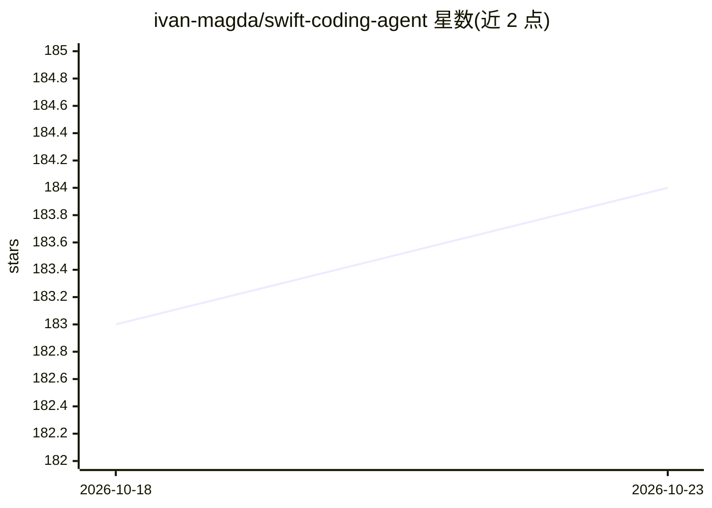

# ivan-magda/swift-coding-agent

⭐ 184 · Swift · MIT · 推送 2026-06-26 · [GitHub](https://github.com/ivan-magda/swift-coding-agent) · [官网](https://ivanmagda.dev/posts/s00-bootstrapping-the-project/) · 个人维护

**Swift 重写的 Claude Code 风格编码 agent，分阶段探索架构**

用 Swift 6.2 从零重建 Claude Code 风格的 CLI 编码 agent，通过 9 个阶段逐步添加机制（agent 循环、文件工具、子 agent、技能加载、上下文压缩、任务系统、后台任务等），用于检验'少量优质工具+紧凑循环优于大型编排层'的假设。Agent 直接调用 Anthropic Messages API，工具包含 bash、读写编辑文件、todo 追踪等；两个 target：Core 库与名为 agent 的 CLI 可执行程序。运行于 macOS 10.15+ 与 Linux，作者明确声明非 Claude Code 完整替代品、非通用多 agent 框架、非生产级工具。需从源码构建。

## 筛选速览

| 维度 | 判定 | 备注 |
|---|---|---|
| AI 角色 | `ai-ecosystem` | LLM/agent 周边工具 |
| 许可风险 | `permissive` | MIT |
| 部署形态 | `None` |  |
| 模型依赖 | locked-api |  |
| 硬件要求 | — | 无带数字的原话,不猜 |
| 安装摩擦 | `low` | 无编译、无系统依赖或容器化 |
| 成熟度 | `idea` | |

## 能力要点

- 固定 agent 循环 + 可扩展工具字典的分阶段架构
- 支持子 agent、技能加载（.md 注入）、3 层上下文压缩、基于文件的任务系统（依赖 DAG）
- 直接对接 Anthropic Messages API（SSE 流式），运行于 macOS/Linux

## 适用场景

- 学习编码 agent 的核心循环与工具设计机制
- 研究上下文压缩、任务状态管理对 agent 可靠性的影响
- 作为 Swift 实现 agent 的参考代码库进行扩展实验

## 场景标签

`编码 Agent` · 领域:编码与开发

## 证据(README 行号)

> L3: Exploring the architecture of coding agents by rebuilding a Claude Code-style CLI from scratch in Swift.
> L81: The agent talks to `POST https://api.anthropic.com/v1/messages` over raw HTTP, built on AsyncHTTPClient. It runs on

## 星数曲线

2026-10-18 183 → 2026-10-23 184（+1）

---
*卡片 v1 · prompt 1.4 · 生成 2026-10-22 · 置信度 high · 依据 README sha `0dded7f898f8` · [字段定义](../../DATASET.md)*
