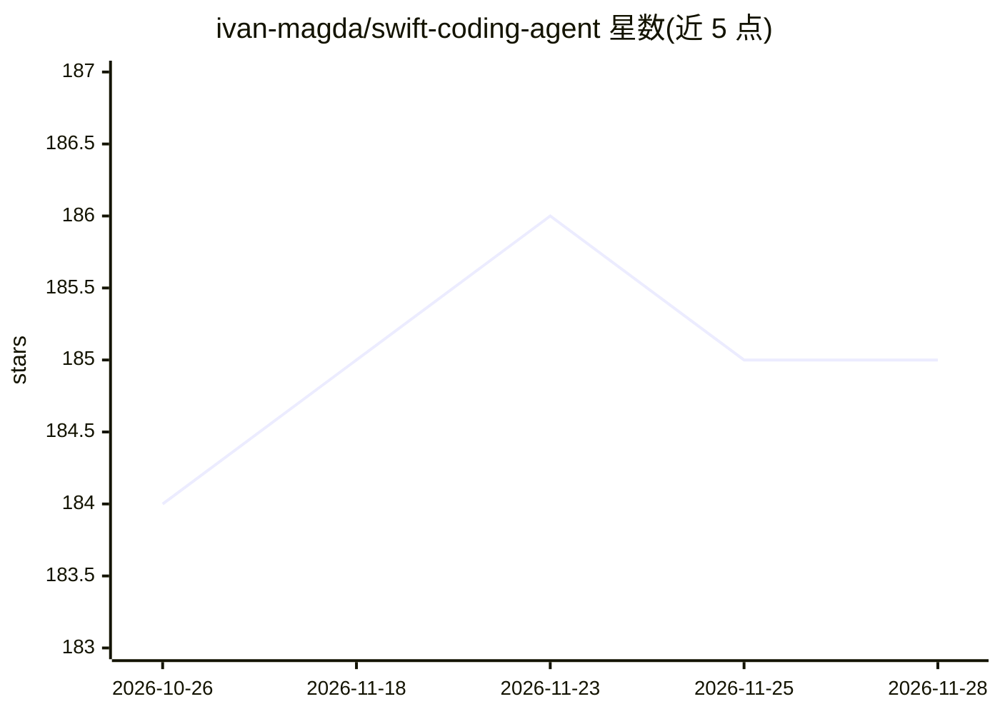

# ivan-magda/swift-coding-agent

⭐ 185 · Swift · MIT · 推送 2026-11-27 · [GitHub](https://github.com/ivan-magda/swift-coding-agent) · [官网](https://ivanmagda.dev/series/swift-coding-agent/) · 个人维护

**Swift 重写的 Claude Code 风格编码 agent CLI，分阶段学习项目**

由 9 部分学习系列配套的 Swift 教学项目：用 Swift 6.2 从零重建 Claude Code 风格的命令行编码 agent，固定一个 agent loop，按 9 个阶段逐步叠加 bash 工具、文件读写编辑、todo 跟踪、子 agent、技能加载、三层上下文压缩、任务系统与后台任务。直接通过 raw HTTP 调用 Anthropic Messages API，采用两 target 的 SPM 结构（Core 库 + CLI 可执行文件），运行于 macOS/Linux。README 明确声明它不是完整克隆、非生产就绪。

## 筛选速览

| 维度 | 判定 | 备注 |
|---|---|---|
| AI 角色 | `ai-native` | 本体是模型或模型工具 |
| 许可风险 | `permissive` | MIT |
| 部署形态 | `None` |  |
| 模型依赖 | locked-api |  |
| 硬件要求 | — | 无带数字的原话,不猜 |
| 安装摩擦 | `low` | 无编译、无系统依赖或容器化 |
| 成熟度 | — | 结构信号不足 |

## 能力要点

- 固定 agent loop + 小工具集的设计，按 00-08 阶段递进实现
- 支持 bash 执行、read/write/edit_file（含路径安全）、todo 写入等工具
- 三层上下文压缩策略（micro/auto/manual）与基于文件的依赖 DAG 任务系统
- 直接对 Anthropic Messages API 发 raw HTTP，基于 AsyncHTTPClient 流式 SSE

## 适用场景

- 逐阶段学习编码 agent 的内部架构与设计取舍
- 以 Swift 6.2 严格并发为参照实现 agent loop 与工具调度
- 研究上下文压缩、子 agent、任务持久化等产品机制的单独实现

## 场景标签

`编码 Agent` `教程课程` · 领域:编码与开发

## 证据(README 行号)

> L3: Exploring the architecture of coding agents by rebuilding a Claude Code-style CLI from scratch in Swift.
> L81: The agent talks to `POST https://api.anthropic.com/v1/messages` over raw HTTP, built on AsyncHTTPClient. It runs on

## 星数曲线

2026-10-26 184 → 2026-11-28 185（+1）

---
*卡片 v1 · prompt 1.4 · 生成 2026-11-28 · 置信度 high · 依据 README sha `678d51a7e080` · [字段定义](../../DATASET.md)*
