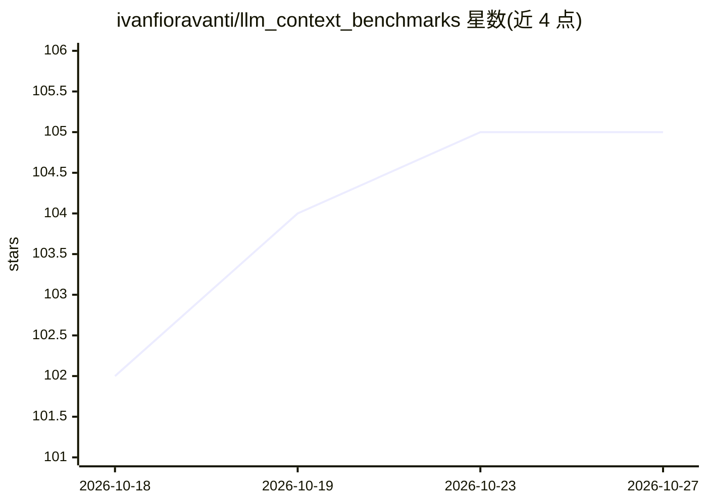

# ivanfioravanti/llm_context_benchmarks

⭐ 105 · Python · Apache-2.0 · 推送 2026-10-15 · [GitHub](https://github.com/ivanfioravanti/llm_context_benchmarks) · 个人维护

**面向多种推理引擎的 LLM 长上下文吞吐基准测试工具**

在 0.5k–128k token 上下文范围内测试提示处理与生成吞吐的基准工具，支持 Ollama(API/CLI 双模式)、MLX 系列、llama.cpp、LM Studio、vLLM、SGLang 及任意 OpenAI 兼容端点等引擎。针对 Apple Silicon 优化但可在任何 Python 环境运行。提供 CLI 与本地 Web UI，支持 Master/Worker 跨机器聚合结果、多运行交互式对比、KL 散度对齐分析，结果可导出为图表/CSV/PDF。

## 筛选速览

| 维度 | 判定 | 备注 |
|---|---|---|
| AI 角色 | `ai-ecosystem` | LLM/agent 周边工具 |
| 许可风险 | `permissive` | Apache-2.0 |
| 部署形态 | `self-host` | docker 或自建部署 |
| 模型依赖 | local-ok | 支持本地模型 |
| 硬件要求 | — | 无带数字的原话,不猜 |
| 安装摩擦 | `low` | 无编译、无系统依赖或容器化 |
| 成熟度 | — | 结构信号不足 |

## 能力要点

- 覆盖 0.5k–128k token 上下文的提示处理与生成吞吐测试
- 支持 Ollama、MLX、llama.cpp、vLLM、SGLang 等引擎及任意 OpenAI 兼容端点
- 本地 Web UI 支持实时进度、多运行对比（最多 8 组）与结果导出
- Master/Worker 模式可聚合多台机器的基准结果

## 适用场景

- 对比不同推理引擎在长上下文下的吞吐表现
- 跨硬件（Apple Silicon/NVIDIA/DGX）汇总基准结果形成对比图景
- 团队通过 Web UI 远程发起并监控多台机器的基准扫描

## 场景标签

`模型评测` · 领域:评测与运维

## 证据(README 行号)

> L3: Benchmark prompt-processing and generation throughput across context sizes
> L4: (0.5k–128k tokens) for many inference engines: Ollama (API & CLI), MLX,
> L5: MLX Distributed, MLX-VLM, llama.cpp, LM Studio, Exo, Apple Foundation Models

## 星数曲线

2026-10-18 102 → 2026-10-27 105（+3）

---
*卡片 v1 · prompt 1.4 · 生成 2026-10-23 · 置信度 high · 依据 README sha `65a66fd684bf` · [字段定义](../../DATASET.md)*
