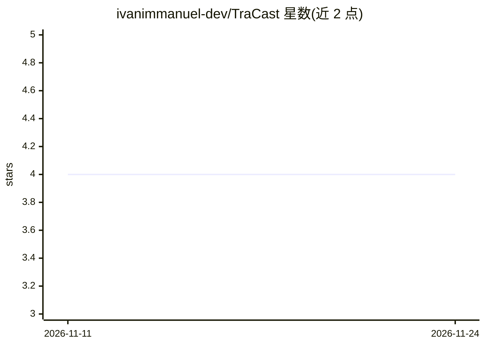

# ivanimmanuel-dev/TraCast

⭐ 4 · Python · NOASSERTION · 推送 2026-11-08 · [GitHub](https://github.com/ivanimmanuel-dev/TraCast) · 个人维护

**交通速度预测研究项目：METR-LA 数据上的循环与联邦图模型实验**

基于 METR-LA 数据集对洛杉矶 207 个道路传感器做 5–60 分钟速度预测的研究项目，覆盖 GRU/LSTM 基线、Graph-GRU、DCRNN 式扩散模型与 Flower 联邦学习，并延伸到预测区间（conformal）、漂移适应、未见传感器预测等实验。README 提供实验设置说明、分报告结果与运行指南，通过 venv + requirements-lock.txt 在 CPU 上运行，实验在 Windows x64 Python 3.11 上记录，CI 覆盖 Windows 与 Ubuntu。

## 筛选速览

| 维度 | 判定 | 备注 |
|---|---|---|
| AI 角色 | `ai-native` | 本体是模型或模型工具 |
| 许可风险 | `none` | NOASSERTION |
| 部署形态 | `desktop` | 安装包/桌面程序 |
| 模型依赖 | — | README 未给出锁定关系 |
| 硬件要求 | — | 无带数字的原话,不猜 |
| 安装摩擦 | `low` | 无编译、无系统依赖或容器化 |
| 成熟度 | — | 结构信号不足 |

## 能力要点

- 支持 GRU、LSTM、Graph-GRU、DCRNN 式扩散模型与基线对比
- 通过 Flower 模拟联邦学习，支持地理划分的多客户端设置
- 提供 conformal 预测区间（split/ACI/CQR）
- 测试覆盖数据泄漏检查，报告数值由保存结果生成

## 适用场景

- 在 METR-LA 上复现交通速度预测实验
- 研究联邦学习与集中训练的精度差异
- 为时空预测学习实验设计（划分、区间、漂移）方法

## 场景标签

`科研工具` · 领域:学习与行业

## 证据(README 行号)

> L7: TraCast forecasts the speed on 207 Los Angeles road sensors 5 to 60 minutes ahead from the last hour of readings (ME
> L3: **Traffic-speed forecasting on METR-LA, from recurrent baselines to federated graph models, on a CPU.**

## 星数曲线

2026-11-11 4 → 2026-11-24 4（+0）

---
*卡片 v1 · prompt 1.4 · 生成 2026-11-21 · 置信度 high · 依据 README sha `8324a81b59be` · [字段定义](../../DATASET.md)*
