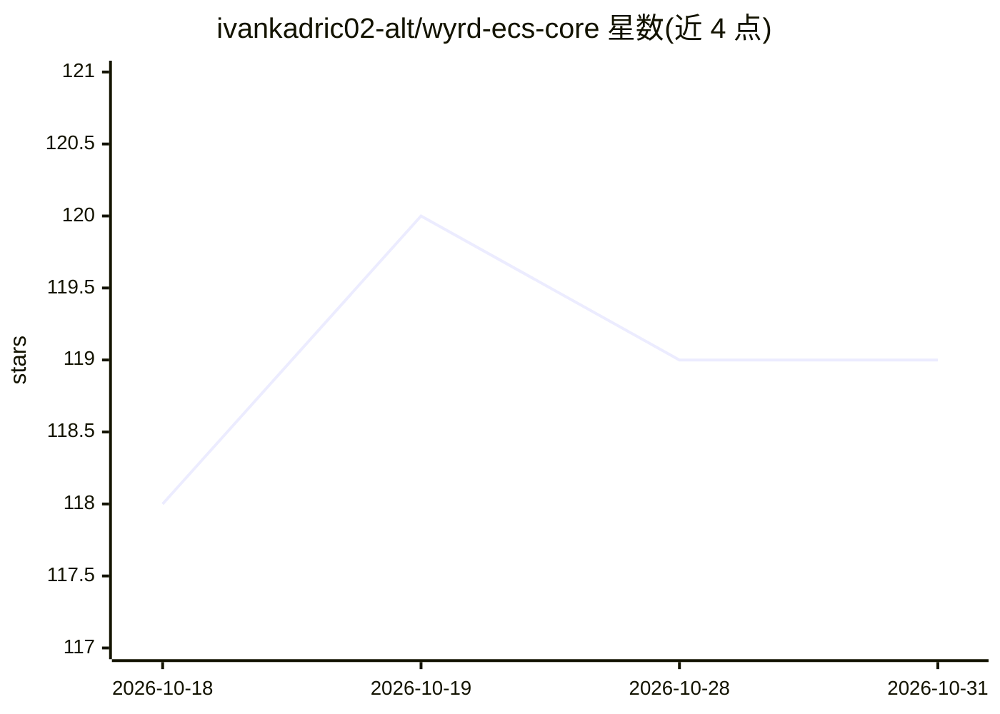

# ivankadric02-alt/wyrd-ecs-core

⭐ 119 · HTML · 推送 2026-10-30 · [GitHub](https://github.com/ivankadric02-alt/wyrd-ecs-core) · 个人维护

**面向 AI 世界模型的 ECS 实时数据架构方案（概念蓝图）**

以 Entity-Component-System 架构承载实时数据流的'世界模型'基础设施蓝图：将传感器、IoT、行情等多源数据摄入为实体与组件，作为 GNN/Transformer 的结构化输入，支持因果链追踪、时间回溯查询、部分状态下的未来外推；并提出实体膜、零知识组件证明、去中心化哈希图等设计。README 为愿景式描述，自称仍处于建设阶段，未见可验证的代码实现，仅给出 ./wyrd CLI 初始化、生成实体与观测遥测的命令示例。适用于自主系统、金融市场、医疗数据建模等场景。

## 筛选速览

| 维度 | 判定 | 备注 |
|---|---|---|
| AI 角色 | `ai-ecosystem` | LLM/agent 周边工具 |
| 许可风险 | `none` | — |
| 部署形态 | `None` |  |
| 模型依赖 | — | README 未给出锁定关系 |
| 硬件要求 | — | 无带数字的原话,不猜 |
| 安装摩擦 | `low` | 无编译、无系统依赖或容器化 |
| 成熟度 | `idea` | |

## 能力要点

- ECS 结构作为 GNN/Transformer 的原生输入，含因果链追踪与概率性未来状态外推
- 数据源中断时以 Ghost Component 预测缺失数据
- 实体膜机制将私有组件与公开组件分离，数据同意为协议级约束
- 支持 Lua 与 WASM 编写 Systems（文档计划中）

## 适用场景

- 为无人机集群、车队等自主系统提供统一状态模型
- 将市场订单与新闻事件建模为时间实体以分析因果关联
- 把患者体征、用药与环境因素纳入统一组件模型做人群分析

## 场景标签

 · 领域:AI 基础设施/数据架构

## 证据(README 行号)

> L42: - **State Space Awareness**: The ECS structure serves as a native input for Graph Neural Networks (GNNs) and Transf
> L44: - **Generative World Extrapolation**: Given a partial world state (e.g., current weather + traffic), the protocol c

## 星数曲线

2026-10-18 118 → 2026-10-31 119（+1）

---
*卡片 v1 · prompt 1.4 · 生成 2026-10-23 · 置信度 low · 依据 README sha `36f9dd259465` · [字段定义](../../DATASET.md)*
