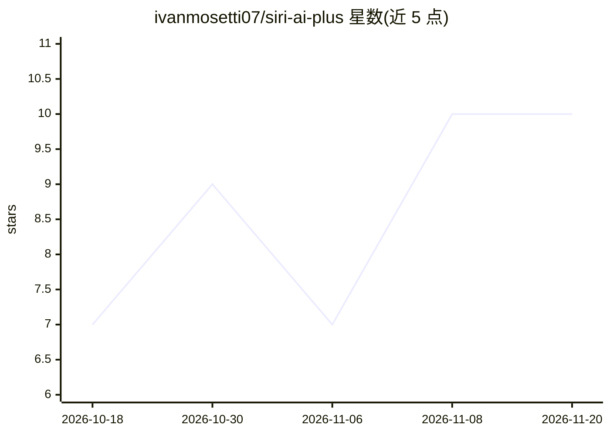

# ivanmosetti07/siri-ai-plus

⭐ 10 · Swift · NOASSERTION · 推送 2026-10-15 · [GitHub](https://github.com/ivanmosetti07/siri-ai-plus) · 个人维护

**macOS 上的本地优先桌面 AI 助手，接入 Apple 应用**

面向 Mac 用户的 AI 助手应用，默认运行 Apple Intelligence 端侧模型，无账号无订阅；可切换本地 Gemma 4（llama.cpp）与 ds4，或经 rizzo-pii 匿名化后调用 ChatGPT/Claude 云端模型。功能含聊天与语音模式、日历/邮件/备忘录等 Apple 应用内嵌操作（写操作需卡片确认）、文档与幻灯片编辑、项目文件夹上下文、Xcode 编码空间、定时任务的 Genius agent、MCP 连接器与面向小模型的子代理调度。为 PolyForm Noncommercial 许可的个人业余项目，提供英文/意大利语界面。

## 筛选速览

| 维度 | 判定 | 备注 |
|---|---|---|
| AI 角色 | `ai-native` | 本体是模型或模型工具 |
| 许可风险 | `none` | NOASSERTION |
| 部署形态 | `desktop` | 安装包/桌面程序 |
| 模型依赖 | — | README 未给出锁定关系 |
| 硬件要求 | — | 无带数字的原话,不猜 |
| 安装摩擦 | `low` | 无编译、无系统依赖或容器化 |
| 成熟度 | `idea` | |

## 能力要点

- 默认 Apple Intelligence 端侧运行，请求不出 Mac
- Gemma 4/ds4 本地模型可按内存选择规格，ChatGPT/Claude 调用前经 rizzo-pii 匿名化
- Apple 应用内嵌聊天，写操作需确认卡并支持 10 分钟撤销
- 30 项基准测试按模型评估工具调用正确率

## 适用场景

- 在 Mac 上用对话管理日历、邮件、备忘录等日常事务
- 隐私优先地在本地运行大模型聊天助手
- 给 Apple 生态接入 MCP 连接器与定时 agent 任务
- 用项目文件夹作为上下文写网站与 SwiftUI 应用

## 场景标签

`AI 助手` · 领域:对话与助手

## 证据(README 行号)

> L6:  An AI assistant for the Mac built on Apple Intelligence, wired into your Apple apps, local first and privacy safe.
> L40: Picture the Siri we've all been waiting for. It actually reads your calendar, answers your email, keeps your notes 
> L128: |**Apple Intelligence**|On your Mac|🔒 Nothing leaves the Mac|The default, free. Small model (about 4K tokens of co

## 星数曲线

2026-10-18 7 → 2026-11-20 10（+3）

---
*卡片 v1 · prompt 1.4 · 生成 2026-11-19 · 置信度 high · 依据 README sha `37056b53f436` · [字段定义](../../DATASET.md)*
