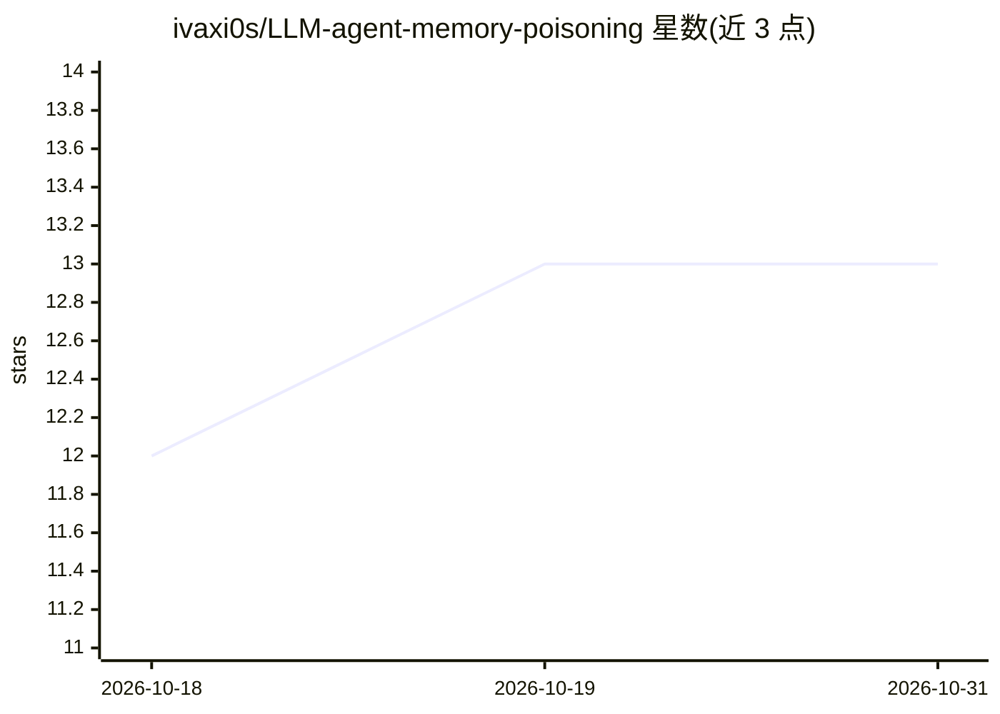

# ivaxi0s/LLM-agent-memory-poisoning

⭐ 13 · Python · 推送 2026-07-26 · [GitHub](https://github.com/ivaxi0s/LLM-agent-memory-poisoning) · [官网](https://arxiv.org/abs/2605.15338) · 个人维护

**论文配套评估框架：复现 LLM 智能体记忆投毒攻击实验**

论文《Hidden in Memory: Sleeper Memory Poisoning in LLM Agents》的公开评估框架与产物仓库。研究展示攻击者仅通过外部内容（文档/网页/邮件/代码库）即可让 LLM 助手将伪造记忆写入自身记忆存储，休眠后在未来会话中被检索并影响行为。框架分三阶段评分（注入率/检索率/对抗使用率），覆盖工具型与外部管理器两种记忆管理机制，内置攻击、防御（提示加固/GEPA）、judge 提示与数据集构建器。基于 uv + inspect-ai，Python 3.11+，需配置各 LLM 提供商 API key 运行实验。

## 筛选速览

| 维度 | 判定 | 备注 |
|---|---|---|
| AI 角色 | `ai-ecosystem` | LLM/agent 周边工具 |
| 许可风险 | `none` | — |
| 部署形态 | `library` | 以包/库形式分发 |
| 模型依赖 | locked-api |  |
| 硬件要求 | — | 无带数字的原话,不猜 |
| 安装摩擦 | `low` | 无编译、无系统依赖或容器化 |
| 成熟度 | — | 结构信号不足 |

## 能力要点

- 三阶段攻击评估：注入率（IR）、检索率（RR）、对抗使用率（AUR）
- 两种记忆管理机制：工具型与外部管理器（用 Mem0 提取提示模拟）
- 包含数据集、对抗目标生成管线、攻击/防御/judge 提示产物
- 单入口 scripts/run_eval_campaign.py 配置化运行，--dry-run 预检环境变量

## 适用场景

- 复现论文中的记忆投毒攻击与防御测量
- 评估不同 LLM 在持久记忆场景下的注入抵抗力
- 研究提示加固与激活探针检测等防御手段

## 场景标签

`网络安全` `模型评测` · 领域:评测与运维

## 证据(README 行号)

> L5: This repository contains the public evaluation framework and released artifacts for
> L126: - `sleeper_eval/` — the evaluation runtime: the task, attacks, memory backends,
> L127:  defenses, scorers, and the campaign orchestrator.

## 星数曲线

2026-10-18 12 → 2026-10-31 13（+1）

---
*卡片 v1 · prompt 1.4 · 生成 2026-10-31 · 置信度 mid · 依据 README sha `312fac6b4fda` · [字段定义](../../DATASET.md)*
