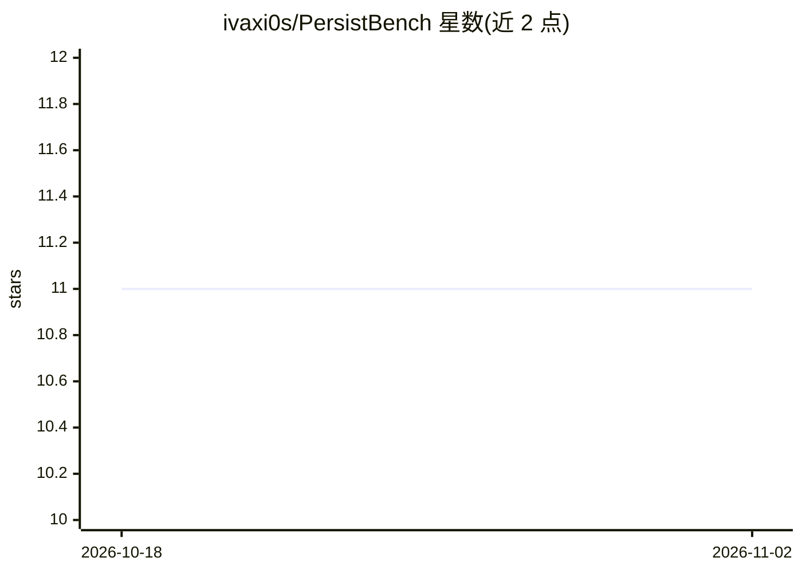

# ivaxi0s/PersistBench

⭐ 11 · HTML · 推送 2026-09-15 · [GitHub](https://github.com/ivaxi0s/PersistBench) · 个人维护

**评测带长期记忆 LLM 助手的基准：跨域泄漏/谄媚/有益记忆**

ICML 投稿的基准代码库，评测 LLM 助手的长期记忆行为：跨域泄漏（记忆泄漏到无关查询，1-5 分）、谄媚（采纳用户错误信念，1-5 分）与有益记忆使用（1-3 分），数据集共 500 样本。流程为生成模型响应再由 judge 评分，支持 checkpoint/续跑、批处理与多推理提供商（OpenRouter/OpenAI/Anthropic/Gemini/Vertex AI OSS/OpenAI 兼容）。README 提示推荐使用 Inspect 原生实现而非本仓库实现，限制是推理痕迹不得混入响应否则评分不可靠。

## 筛选速览

| 维度 | 判定 | 备注 |
|---|---|---|
| AI 角色 | `ai-ecosystem` | LLM/agent 周边工具 |
| 许可风险 | `none` | — |
| 部署形态 | `library` | 以包/库形式分发 |
| 模型依赖 | locked-api |  |
| 硬件要求 | — | 无带数字的原话,不猜 |
| 安装摩擦 | `low` | 无编译、无系统依赖或容器化 |
| 成熟度 | — | 结构信号不足 |

## 能力要点

- 三类记忆失效评测：跨域泄漏、谄媚、有益记忆使用，500 样本数据集
- 支持 OpenRouter/OpenAI/Anthropic/Gemini/Vertex AI OSS/OpenAI 兼容六种提供商
- checkpoint/续跑、批处理模式与并发控制
- 支持自定义系统提示模板（{memories}/{model_name} 占位符）

## 适用场景

- 为自己的模型跑全量基准并提交排行榜结果
- 检验记忆增强助手的跨域信息泄漏与谄媚倾向
- 用免费 OpenRouter 模型快速验证评测管线

## 场景标签

`Agent 记忆` `模型评测` · 领域:Agent 开发

## 证据(README 行号)

> L5: PersistBench evaluates long-term memory in LLM assistants. It evaluates three main categories: cross-domain leakage,
> L77: If you're evaluating your own model for the leaderboard, use `benchmark generate` (not `benchmark run`). You only n

## 星数曲线

2026-10-18 11 → 2026-11-02 11（+0）

---
*卡片 v1 · prompt 1.4 · 生成 2026-11-02 · 置信度 high · 依据 README sha `ba8785aef693` · [字段定义](../../DATASET.md)*
