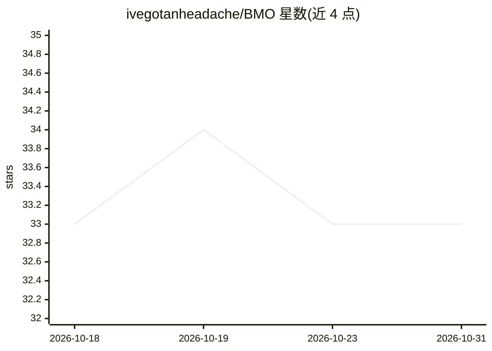

# ivegotanheadache/BMO

⭐ 33 · Python · NOASSERTION · 推送 2026-02-26 · [GitHub](https://github.com/ivegotanheadache/BMO) · 个人维护

**树莓派 5 上的本地 AI 陪伴机器人：可识别物体并对话**

以《探险时光》角色 BMO 为原型、运行在 Raspberry Pi 5 上的本地 AI 语音陪伴设备项目。当前支持简单物体识别与语音对话；作者正在开发人脸/语音识别与游戏功能。后端可接 OpenAI API 或本地 Mistral API 服务器（Nous Hermes 2 Mistral 7B），自动回退与切换；语音链路采用 Vosk 语音识别与 Piper 语音合成，支持英/意/西三种语言提示词。需自行准备 RPi 5、摄像头、麦克风、音箱与显示屏等硬件，从源码以 Python venv 方式运行。

## 筛选速览

| 维度 | 判定 | 备注 |
|---|---|---|
| AI 角色 | `ai-native` | 本体是模型或模型工具 |
| 许可风险 | `none` | NOASSERTION |
| 部署形态 | `library` | 以包/库形式分发 |
| 模型依赖 | — | README 未给出锁定关系 |
| 硬件要求 | — | 无带数字的原话,不猜 |
| 安装摩擦 | `low` | 无编译、无系统依赖或容器化 |
| 成熟度 | `idea` | |

## 能力要点

- OpenAI 与本地 Mistral API 服务器双后端，支持自动回退与切换
- Vosk 语音识别 + Piper 语音合成 + IMX219 摄像头物体识别
- BaseHandler 可扩展为通用 LLM 类与多用途 agent
- 支持英语、意大利语、西班牙语三种语言提示词

## 适用场景

- 在树莓派上搭建本地运行的语音对话陪伴设备
- 户外用 OpenAI、家中用本地 Mistral 服务器切换使用
- 基于 BaseHandler 扩展自己的多用途 agent 功能

## 场景标签

`语音 Agent` `目标检测` · 领域:对话与助手

## 证据(README 行号)

> L11:  I found an old project for an RPi 3 and thought it would be cool to rebuild it from scratch on an RPi 5. And here 
> L16:  The strength of Rpi-voice-assistant is that it can use both OpenAI and Mistral (and other APIs in the future), wit

## 星数曲线

2026-10-18 33 → 2026-10-31 33（+0）

---
*卡片 v1 · prompt 1.4 · 生成 2026-10-25 · 置信度 mid · 依据 README sha `b388b87f7acf` · [字段定义](../../DATASET.md)*
