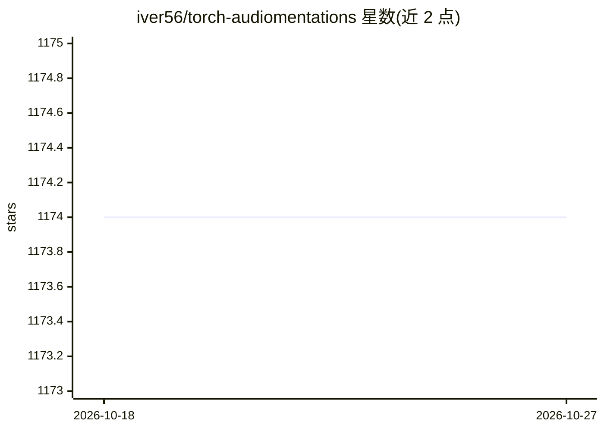

# iver56/torch-audiomentations

⭐ 1,174 · Python · MIT · 推送 2025-11-24 · [GitHub](https://github.com/iver56/torch-audiomentations) · 个人维护

**PyTorch 音频数据增强库：为深度学习训练提供 GPU 加速的波形变换**

基于 PyTorch 的音频数据增强库，提供加噪、滤波、变调、增益、峰值归一化、通道乱序等 15+ 种波形变换，变换继承 nn.Module，可嵌入 PyTorch 神经网络模型。支持 CPU 与 GPU(CUDA)、多声道批量音频，多数变换可微分，提供 per_batch/per_example/per_channel 三种模式，另支持从 dict/json/yaml 加载增强配置。pip 安装。限制：仍处早期开发阶段 API 可能变动，多 GPU/DDP 非官方支持，多进程场景可能有内存泄漏。面向训练音频模型（分类、相位感知模型等）的开发者与科研用户。

## 筛选速览

| 维度 | 判定 | 备注 |
|---|---|---|
| AI 角色 | `ai-ecosystem` | LLM/agent 周边工具 |
| 许可风险 | `permissive` | MIT |
| 部署形态 | `library` | 以包/库形式分发 |
| 模型依赖 | — | README 未给出锁定关系 |
| 硬件要求 | — | 无带数字的原话,不猜 |
| 安装摩擦 | `medium` | 含编译或系统依赖之一 |
| 成熟度 | `idea` | |

## 能力要点

- 变换继承 nn.Module，可集成进 PyTorch 网络模型
- 支持 CPU 与 GPU(CUDA) 批量多声道音频
- 多数变换可微分，三种随机化分组模式
- 支持 Compose/OneOf/SomeOf 组合与 dict/json/yaml 配置加载

## 适用场景

- 训练音频分类等模型时做数据增强
- 在 GPU 上加速增强流程避免训练瓶颈
- 用同一增强配置文件复现实验设置

## 场景标签

 · 领域:音频/机器学习工具库

## 证据(README 行号)

> L8: Audio data augmentation in PyTorch. Inspired by audiomentations.
> L12: * Transforms extend `nn.Module`, so they can be integrated as a part of a pytorch neural network model

## 星数曲线

2026-10-18 1,174 → 2026-10-27 1,174（+0）

---
*卡片 v1 · prompt 1.4 · 生成 2026-10-21 · 置信度 high · 依据 README sha `76c8738c99fc` · [字段定义](../../DATASET.md)*
