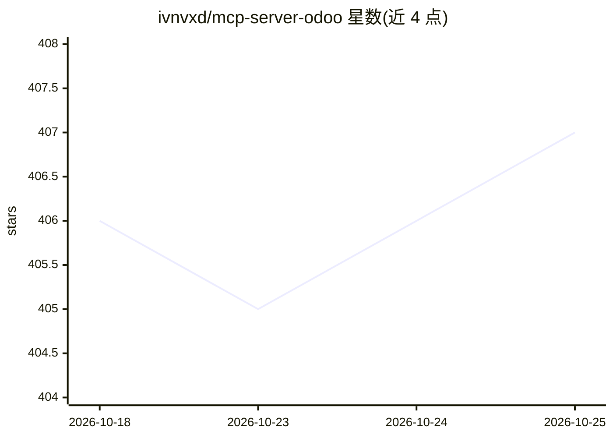

# ivnvxd/mcp-server-odoo

⭐ 407 · Python · MPL-2.0 · 推送 2026-10-18 · [GitHub](https://github.com/ivnvxd/mcp-server-odoo) · 个人维护

**让 AI 助手通过 MCP 安全读写 Odoo ERP 数据的服务器**

一个 Model Context Protocol 服务器，运行在本地，通过 XML-RPC/JSON-2 连接 Odoo 实例，向 Claude Desktop、Claude Code、Cursor、VS Code Copilot、Windsurf、Zed 等 MCP 客户端暴露工具与资源：检索/创建/更新/删除记录、计数、字段检查、服务端聚合、工作流方法调用与附件读取。支持 API key 或用户名密码认证，标准模式需在 Odoo 16.0+ 安装 MCP 模块做权限控制，YOLO 模式免模块适配任意版本但仅限测试。提供 pip、Docker、源码安装，支持 stdio 与 streamable-http 传输。

## 筛选速览

| 维度 | 判定 | 备注 |
|---|---|---|
| AI 角色 | `ai-ecosystem` | LLM/agent 周边工具 |
| 许可风险 | `permissive` | MPL-2.0 |
| 部署形态 | `self-host` | docker 或自建部署 |
| 模型依赖 | — | README 未给出锁定关系 |
| 硬件要求 | — | 无带数字的原话,不猜 |
| 安装摩擦 | `low` | 无编译、无系统依赖或容器化 |
| 成熟度 | — | 结构信号不足 |

## 能力要点

- 覆盖 Odoo 记录 CRUD、计数、字段检查与服务端聚合的工具集
- 标准模式通过 Odoo MCP 模块做模型级权限控制，权限检查每次调用生效
- YOLO 模式经 XML-RPC/JSON-2 免模块对接任意 Odoo 版本（限测试）
- 多公司作用域（ODOO_ALLOWED_COMPANIES）与二进制附件资源读取

## 适用场景

- 让 Claude 等 AI 助手用自然语言查询和操作我的 Odoo 业务数据
- 在 IDE 内通过 MCP 直接触发 Odoo 工作流（过账发票、确认销售订单）
- 多公司 Odoo 数据库中按公司作用域执行 AI 操作

## 场景标签

 · 领域:企业软件集成/AI 工具接入

## 证据(README 行号)

> L10: An MCP server that enables AI assistants like Claude to interact with Odoo ERP systems. Access business data, searc
> L44: The MCP server runs on your **local computer** (where Claude Desktop is installed), not on your Odoo server. You ne
> L71:  Claude Desktop

## 星数曲线

2026-10-18 406 → 2026-10-25 407（+1）

---
*卡片 v1 · prompt 1.4 · 生成 2026-10-21 · 置信度 mid · 依据 README sha `e14ee495c5a5` · [字段定义](../../DATASET.md)*
