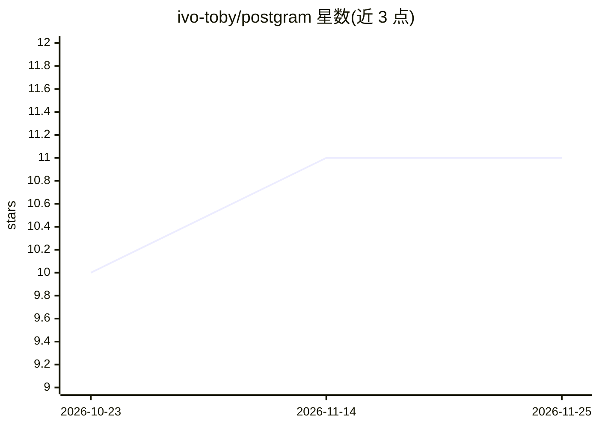

# ivo-toby/postgram

⭐ 11 · TypeScript · AGPL-3.0 · 推送 2026-11-14 · [GitHub](https://github.com/ivo-toby/postgram) · [官网](https://postgram.dev/) · 个人维护

**自托管知识与 Agent 记忆后端：人机共用同一数据语料**

基于 PostgreSQL + pgvector 的自托管后端，集中存储笔记、文档、任务、人员、项目、决策与 agent 记忆等类型化实体；人通过浏览器 UI 和 CLI 访问，agent 通过 MCP、REST 或 CLI 访问同一语料。关键机制包括混合关键词+向量检索与 RRF 融合、知识图谱与 LLM 关系抽取（可选）、durable_memory 与 session_context 两种记忆角色及后台 grooming 流程。面向单人或小型可信团队的本地/单 VM 部署，明确声明不是托管 SaaS；嵌入服务不可用时仍可启动写入，但富化与检索会失败。

## 筛选速览

| 维度 | 判定 | 备注 |
|---|---|---|
| AI 角色 | `ai-ecosystem` | LLM/agent 周边工具 |
| 许可风险 | `viral` | AGPL-3.0 |
| 部署形态 | `self-host` | docker 或自建部署 |
| 模型依赖 | local-ok | 支持本地模型 |
| 硬件要求 | — | 无带数字的原话,不猜 |
| 安装摩擦 | `low` | 无编译、无系统依赖或容器化 |
| 成熟度 | — | 结构信号不足 |

## 能力要点

- 类型化实体存储 + 混合关键词/向量检索（RRF 融合）+ 知识图谱
- durable_memory 与 session_context 分离，支持归档/晋升式 grooming
- MCP (Streamable HTTP)、REST API 与 CLI 三种接入方式
- 加密备份、审计日志与作用域 API key 认证

## 适用场景

- 让多个 agent 和设备共享同一份私有知识语料
- 管理 agent 会话上下文并提炼为长期记忆
- 自托管个人知识库与 GTD 任务管理
- 本地 Markdown 仓库的文档同步与检索

## 场景标签

`Agent 记忆` `知识库管理` `知识图谱` `RAG` · 领域:Agent 开发

## 证据(README 行号)

> L5:  A self-hosted productivity and knowledge backend for humans and AI agents.
> L167: - a Streamable HTTP MCP endpoint for agent-native tool access
> L176: Postgram is a TypeScript Node.js application built around a service layer.

## 星数曲线

2026-10-23 10 → 2026-11-25 11（+1）

---
*卡片 v1 · prompt 1.4 · 生成 2026-11-18 · 置信度 high · 依据 README sha `8f235b379261` · [字段定义](../../DATASET.md)*
