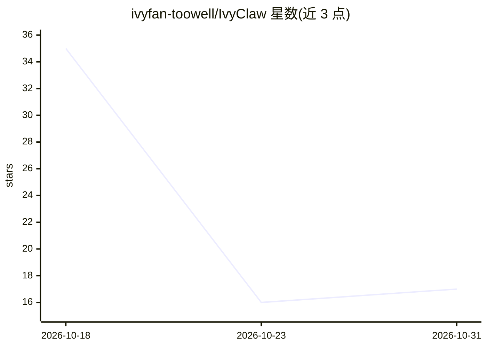

# ivyfan-toowell/IvyClaw

⭐ 17 · Python · 推送 2026-10-11 · [GitHub](https://github.com/ivyfan-toowell/IvyClaw) · 个人维护 · 中文 README

**面向软件研发任务的多智能体 Agent 工程系统**

基于 DeepAgents / LangGraph 构建的多智能体软件研发系统，Planner / Researcher / Coder / Tester / Reviewer 分工完成任务规划、检索、实现、测试与审查。机制上提供按角色与复杂度的模型路由（支持 OpenAI Compatible API）、Git/pytest/MCP 等工具调用、Docker/Daytona 沙箱执行、PostgreSQL+Redis 状态持久化、ARQ 异步长任务、Human-in-the-Loop 审批、多渠道接入（CLI/Web API/飞书/Webhook）、网关鉴权多租户与 Prometheus/Grafana/LangSmith 可观测。面向开发者与研究者，作者声明部分能力为工程原型或演示实现，生产使用需完善认证与安全配置。

## 筛选速览

| 维度 | 判定 | 备注 |
|---|---|---|
| AI 角色 | `ai-native` | 本体是模型或模型工具 |
| 许可风险 | `none` | — |
| 部署形态 | `self-host` | docker 或自建部署 |
| 模型依赖 | — | README 未给出锁定关系 |
| 硬件要求 | — | 无带数字的原话,不猜 |
| 安装摩擦 | `low` | 无编译、无系统依赖或容器化 |
| 成熟度 | `idea` | |

## 能力要点

- 五角色多智能体协作与按角色/复杂度的模型路由
- Docker/Daytona 沙箱隔离执行 Agent 生成代码
- PostgreSQL + LangGraph Checkpointer 状态持久化与 ARQ 异步长任务
- CLI / Web API / 飞书 WebSocket / Webhook 多渠道接入与 API Key 多租户网关

## 适用场景

- 让 Agent 按规划-编码-测试-审查流程完成软件研发任务
- 实践和学习多智能体系统的工程化落地
- 通过飞书或 Webhook 将研发 Agent 接入团队工作流

## 场景标签

`Agent 框架` `多智能体` `编码 Agent` · 领域:Agent 开发

## 证据(README 行号)

> L7: > **面向软件研发任务的多智能体 AI Agent 工程系统**
> L24: - 🤖 **多智能体协作**：Planner / Researcher / Coder / Tester / Reviewer 分工完成研发任务

## 星数曲线

2026-10-18 35 → 2026-10-31 17（-18）

---
*卡片 v1 · prompt 1.4 · 生成 2026-10-30 · 置信度 high · 依据 README sha `d7bc6d2208ac` · [字段定义](../../DATASET.md)*
