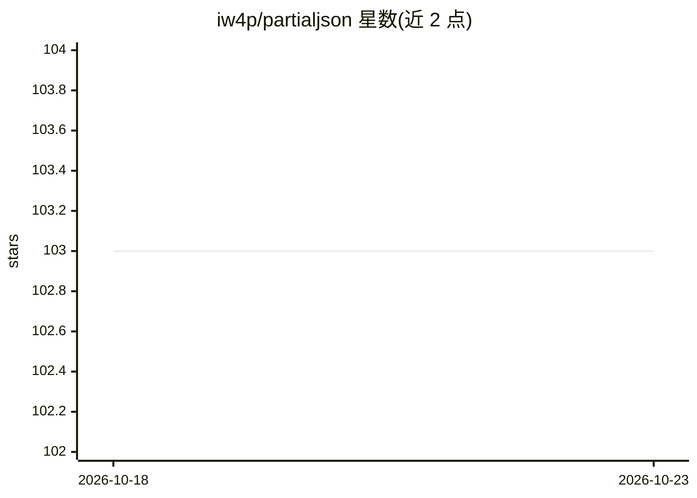

# iw4p/partialjson

⭐ 103 · Python · MIT · 推送 2026-09-11 · [GitHub](https://github.com/iw4p/partialjson) · 个人维护

**解析 LLM 流式输出中不完整 JSON 的 Python 库**

Python 解析库，用于解析部分到达或不完整的 JSON 文本，常用于解析 LLM 的流式 JSON 响应。返回已到达文本对应的部分结果，仅保留尚不能确定的内容；strict 模式下处理未完成的转义与半个 emoji，strict=False 返回原始文本。支持 JSON5（注释、无引号键、单引号），可选 json5 依赖加速完整文档解析。对完整值后跟多余文本的情况，通过 on_extra_token 回调处理。面向需要实时消费 LLM JSON 输出的开发者，pip 安装，附回归测试（冻结 1.1.0 解析器逐前缀对比）。

## 筛选速览

| 维度 | 判定 | 备注 |
|---|---|---|
| AI 角色 | `ai-ecosystem` | LLM/agent 周边工具 |
| 许可风险 | `permissive` | MIT |
| 部署形态 | `library` | 以包/库形式分发 |
| 模型依赖 | — | README 未给出锁定关系 |
| 硬件要求 | — | 无带数字的原话,不猜 |
| 安装摩擦 | `low` | 无编译、无系统依赖或容器化 |
| 成熟度 | — | 结构信号不足 |

## 能力要点

- 解析不完整/部分 JSON，返回流式过程中已确定的部分结果
- strict 模式处理未完成转义与半个 emoji；strict=False 保留原始文本
- 支持 JSON5（注释、无引号键、单引号），可选依赖加速完整文档
- on_extra_token 回调处理完整值后的多余 token

## 适用场景

- 实时解析 ChatGPT 等 LLM 流式返回的未完成 JSON
- 修复 LLM 输出的非法 JSON 后再消费
- 解析含注释/单引号的 JSON5 部分文本

## 场景标签

 · 领域:LLM 基础设施/文本解析

## 证据(README 行号)

> L5: ## Parse Partial and incomplete JSON in python
> L52: Text that has already arrived is returned; only what cannot be decided yet is held back. With `strict=True` (the de

## 星数曲线

2026-10-18 103 → 2026-10-23 103（+0）

---
*卡片 v1 · prompt 1.4 · 生成 2026-10-23 · 置信度 high · 依据 README sha `79b241d8fea1` · [字段定义](../../DATASET.md)*
