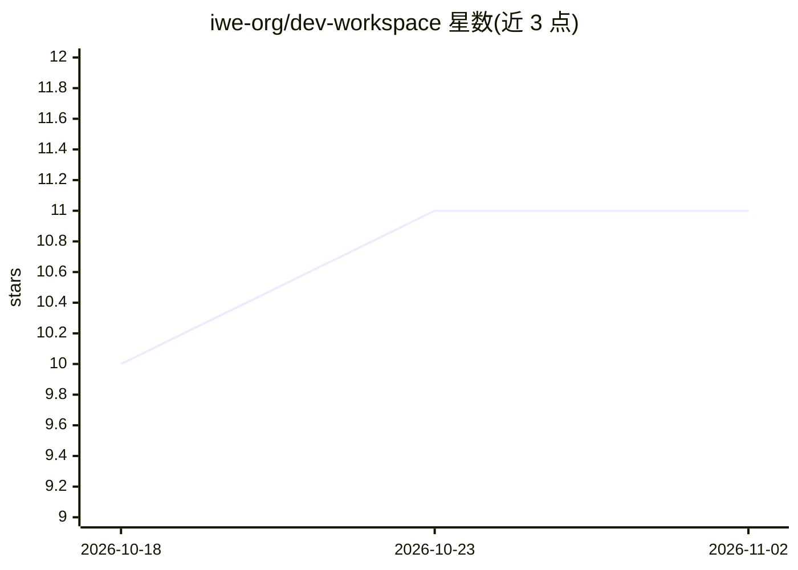

# iwe-org/dev-workspace

⭐ 11 · MIT · 推送 2026-10-23 · [GitHub](https://github.com/iwe-org/dev-workspace) · [官网](https://iwe.md/templates/dev-workspace/) · 组织维护

**给编码 agent 的项目知识库模板：markdown 可查询图谱**

一个以 markdown 组织的项目知识库模板，覆盖产品定义、计划、功能、缺陷、规格、架构与发布记录，文档以带 schema 校验的 frontmatter（type、provenance、status 等）描述，链接即结构，形成可查询的项目图谱。编码 agent 在每次会话开始读取、结束前写回，作为跨会话记忆。配套 IWE CLI 提供查询、重命名重构与校验，编辑器经 LSP 支持。符合 OKF v0.2 规范，通过 GitHub 模板或 clone 使用，setup 技能从现有代码库起草初始文档。

## 筛选速览

| 维度 | 判定 | 备注 |
|---|---|---|
| AI 角色 | `ai-ecosystem` | LLM/agent 周边工具 |
| 许可风险 | `permissive` | MIT |
| 部署形态 | `desktop` | 安装包/桌面程序 |
| 模型依赖 | — | README 未给出锁定关系 |
| 硬件要求 | — | 无带数字的原话,不猜 |
| 安装摩擦 | `low` | 无编译、无系统依赖或容器化 |
| 成熟度 | — | 结构信号不足 |

## 能力要点

- 产品/计划/功能/缺陷/规格/架构/发布等文档组织为可查询图谱
- 带 schema 校验的 frontmatter，CI 中检查 OKF v0.2 一致性
- IWE CLI 提供 find/tree/rename/schema validate，LSP 支持 VSCode/Neovim/Zed/Helix
- setup 技能读取现有代码库起草产品文档与架构说明

## 适用场景

- 让编码 agent 跨会话保留设计决策与项目上下文
- 用图查询代替重读代码库回答'发布了什么/谁依赖这个规格'
- 按 explore→plan→implement→verify→ship 循环驱动 agent 工作

## 场景标签

`Agent 记忆` `知识库管理` · 领域:Agent 开发

## 证据(README 行号)

> L6: **Memory for your coding agent.** A ready-to-use markdown knowledge base for a
> L29: 2. **Install IWE** — the CLI that gives the graph its queries,
> L36: 3. **Open the workspace in your coding agent** (Claude Code, or anything that

## 星数曲线

2026-10-18 10 → 2026-11-02 11（+1）

---
*卡片 v1 · prompt 1.4 · 生成 2026-11-02 · 置信度 high · 依据 README sha `3c4cfb4cd89c` · [字段定义](../../DATASET.md)*
