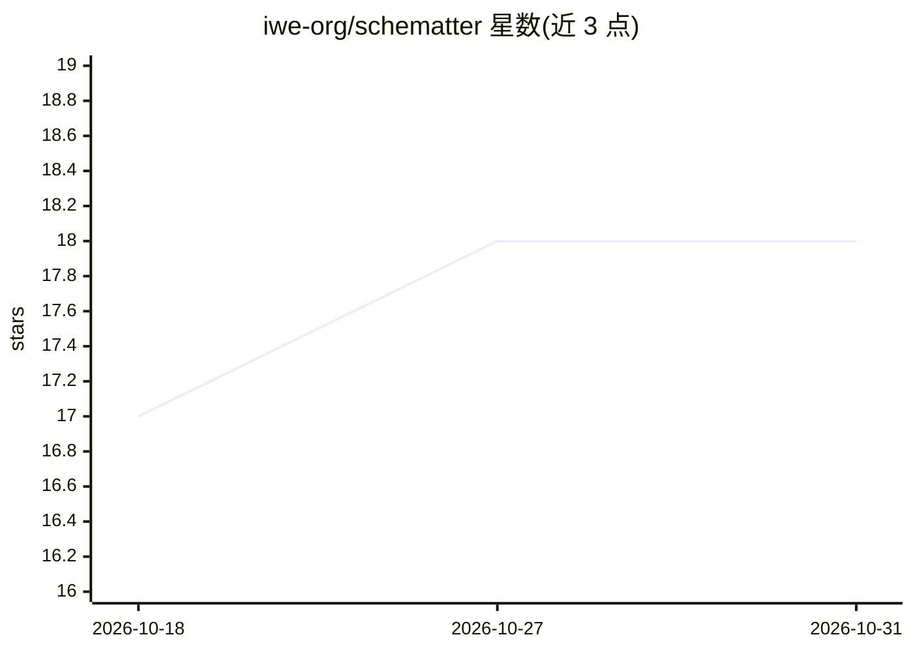

# iwe-org/schematter

⭐ 18 · Rust · Apache-2.0 · 推送 2026-08-30 · [GitHub](https://github.com/iwe-org/schematter) · 组织维护

**校验 markdown 页面结构合规的文档 schema 验证器（Rust）**

schematter 是 document-schema 格式的验证器：用 JSON-Schema 风格的 YAML schema 声明 markdown 页面应有的 frontmatter 字段、章节顺序、块类型、嵌套深度与 token 预算，输入文档与 schema 后输出违规清单。frontmatter 按字面 JSON Schema（draft 2020-12）校验；token 用 o200k_base BPE 计数。面向维护 agent 生成的 markdown 知识库的开发者，定位为“schema 管形状、prompt 管语义”的分工中的形状校验端。提供 CLI（可接 CI/git hooks/agent 写入路径）、浏览器 playground、三个 Rust crate（二进制与库，库可嵌入），预编译二进制覆盖 Linux/macOS/Windows，Apache-2.0 许可。

## 筛选速览

| 维度 | 判定 | 备注 |
|---|---|---|
| AI 角色 | `ai-ecosystem` | LLM/agent 周边工具 |
| 许可风险 | `permissive` | Apache-2.0 |
| 部署形态 | `desktop` | 安装包/桌面程序 |
| 模型依赖 | — | README 未给出锁定关系 |
| 硬件要求 | — | 无带数字的原话,不猜 |
| 安装摩擦 | `low` | 无编译、无系统依赖或容器化 |
| 成熟度 | — | 结构信号不足 |

## 能力要点

- frontmatter 用字面 JSON Schema（draft 2020-12）校验，body 部分镜像 JSON Schema 关键词（pattern/const/minContains 等）
- maxTokens 按 o200k_base BPE 计数，maxDepth 限制标题嵌套
- -f json 输出结构化报告，--explain 打印章节绑定调试轨迹，退出码适配 CI/git hooks
- 附带 OKF 一致性校验 schema（examples/okf/）与浏览器 playground

## 适用场景

- 校验 agent 维护的 markdown 知识库是否符合结构约定
- 在 CI、git hook 或 agent 写入路径中机械拦截超预算/缺章节的页面
- 为团队文档制定并执行 frontmatter 与章节结构规范

## 场景标签

 · 领域:开发工具/文档工程

## 证据(README 行号)

> L17: Markdown knowledge bases are increasingly written by agents: memory stores,
> L27: benchmarking markdown knowledge graphs as agent memory for
> L38: event's). `schematter` is the shape half, extracted as a standalone tool: a

## 星数曲线

2026-10-18 17 → 2026-10-31 18（+1）

---
*卡片 v1 · prompt 1.4 · 生成 2026-10-29 · 置信度 high · 依据 README sha `ed3310cca7d2` · [字段定义](../../DATASET.md)*
