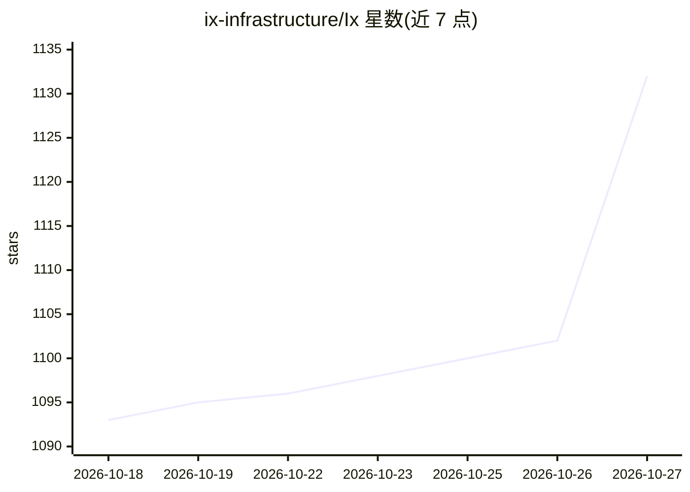

# ix-infrastructure/Ix

⭐ 1,132 · TypeScript · Apache-2.0 · 推送 2026-10-26 · [GitHub](https://github.com/ix-infrastructure/Ix) · [官网](https://www.ix-infra.com) · 组织维护

**代码库结构图谱工具：解析仓库供人与 AI 客户端查询**

Ix 用 tree-sitter 解析仓库，将符号、调用与导入关系持久化为本地图谱（ArangoDB + memory layer，经 Docker 运行），通过 ix CLI、MCP 服务器与 Compass 可视化器三个客户端读取。面向开发者与编码 agent，提供 explain/trace/impact 等查询命令替代全文检索，支持 27 种语言的符号提取。安装脚本自动检查并安装 Node.js 22+、Git、ripgrep 与 Docker，为 Apple Silicon macOS、Linux、Windows x86-64 提供预编译包，Intel Mac 需 Homebrew 源码构建。

## 筛选速览

| 维度 | 判定 | 备注 |
|---|---|---|
| AI 角色 | `ai-ecosystem` | LLM/agent 周边工具 |
| 许可风险 | `permissive` | Apache-2.0 |
| 部署形态 | `self-host` | docker 或自建部署 |
| 模型依赖 | — | README 未给出锁定关系 |
| 硬件要求 | — | 无带数字的原话,不猜 |
| 安装摩擦 | `low` | 无编译、无系统依赖或容器化 |
| 成熟度 | — | 结构信号不足 |

## 能力要点

- tree-sitter 解析 27 种语言的符号/调用/导入并持久化为本地图谱
- stdio MCP 服务器，可注册到 Claude Code、Codex、Cursor 等 7 种客户端
- 查询命令返回有界的结构切片而非整文件，图谱跨会话保留
- Docker 化本地后端（ArangoDB + memory layer），CLI 预编译三平台发布

## 适用场景

- 为我的编码 agent 提供持久的代码结构上下文，减少 prompt 塞整文件
- 接手陌生仓库时快速查询符号定义、调用链与修改影响面
- 团队维护一份跨会话可复用的架构图谱与可视化视图

## 场景标签

`Agent 记忆` `知识图谱` · 领域:Agent 开发

## 证据(README 行号)

> L78: `ix map` parses your repository with tree-sitter, extracts symbols, calls and
> L99: Ix ships a stdio MCP server, so any MCP-capable client can use the same graph tools.
> L107: `install` knows **Claude Code, Codex, Cursor, VS Code, Gemini CLI, OpenClaw and

## 星数曲线

2026-10-18 1,093 → 2026-10-27 1,132（+39）

---
*卡片 v1 · prompt 1.4 · 生成 2026-10-21 · 置信度 mid · 依据 README sha `6286a5ca0ee5` · [字段定义](../../DATASET.md)*
