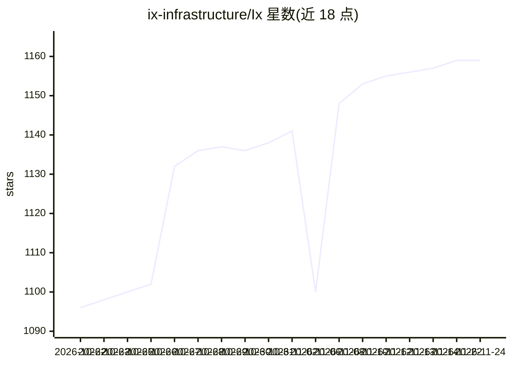

# ix-infrastructure/Ix

⭐ 1,160 · TypeScript · Apache-2.0 · 推送 2026-11-24 · [GitHub](https://github.com/ix-infrastructure/Ix) · [官网](https://www.ix-infra.com) · 组织维护

**把代码库解析成持久图，供人与 AI agent 查询结构**

Ix 用 tree-sitter 解析仓库，把符号、调用、导入关系存为本地持久化图（ArangoDB 后端经 Docker 运行）。提供 CLI、MCP 服务器和 Compass 可视化三类客户端：ix map 建图，ix explain/trace/impact 查询单个符号或流程的有限范围答案，图跨会话存活。支持 27 种语言及配置格式解析；ix mcp install 可向 Claude Code、Codex、Cursor 等客户端注册。自述内部测量 token 用量降低 30–99.7%，声明非公开基准。

## 筛选速览

| 维度 | 判定 | 备注 |
|---|---|---|
| AI 角色 | `ai-ecosystem` | LLM/agent 周边工具 |
| 许可风险 | `permissive` | Apache-2.0 |
| 部署形态 | `self-host` | docker 或自建部署 |
| 模型依赖 | — | README 未给出锁定关系 |
| 硬件要求 | — | 无带数字的原话,不猜 |
| 安装摩擦 | `low` | 无编译、无系统依赖或容器化 |
| 成熟度 | — | 结构信号不足 |

## 能力要点

- tree-sitter 解析 27 种语言为持久化符号/调用/导入图
- stdio MCP 服务器，附带向 7 种 AI 客户端的自动注册工具
- 查询输出 --format llm 为 token 最小化格式
- 图存于本地 Docker 后端，跨会话持久

## 适用场景

- 让编码 agent 通过 MCP 查询代码结构而非整文件粘贴
- 追踪某个符号或调用流的上下游影响
- 可视化浏览仓库架构与结构问题

## 场景标签

`Agent 记忆` · 领域:Agent 开发

## 证据(README 行号)

> L6:  Ix parses your repository into a persistent system graph of symbols, calls, imports and relationships
> L86: Ix ships a stdio MCP server, so any MCP-capable client can use the same graph tools.
> L94: `install` knows **Claude Code, Codex, Cursor, VS Code, Gemini CLI, OpenClaw and

## 星数曲线

2026-10-22 1,096 → 2026-11-24 1,159（+63）

---
*卡片 v1 · prompt 1.4 · 生成 2026-11-24 · 置信度 high · 依据 README sha `d370bae0e3e1` · [字段定义](../../DATASET.md)*
