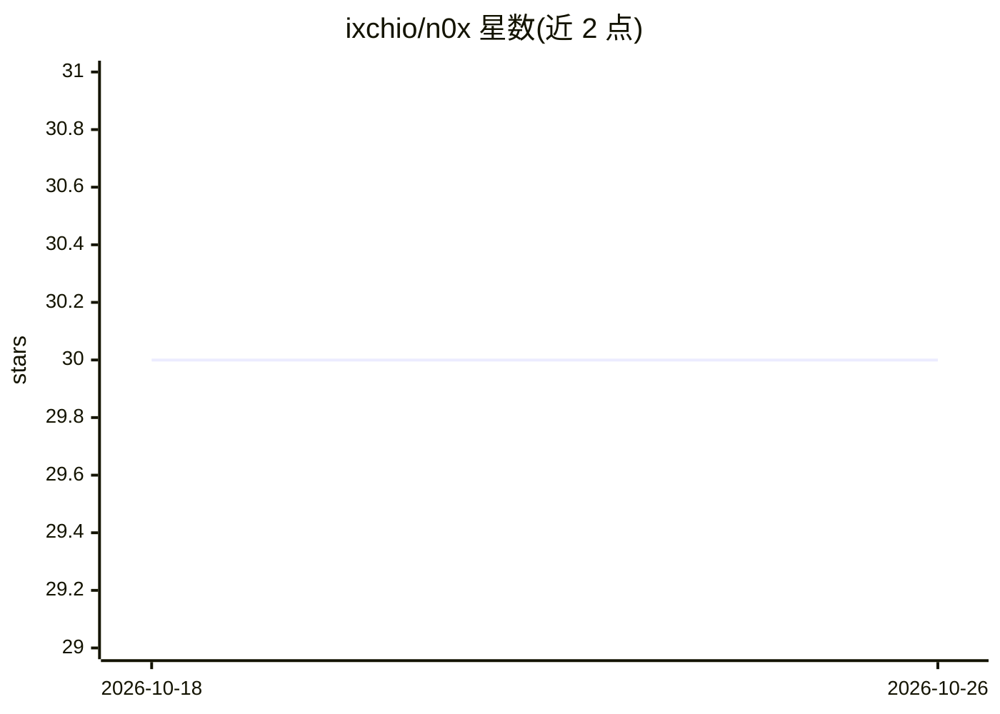

# ixchio/n0x

⭐ 30 · TypeScript · MIT · 推送 2026-08-24 · [GitHub](https://github.com/ixchio/n0x) · [官网](https://n0xth.vercel.app) · 个人维护

**浏览器内本地优先的文档问答与 AI 工作台，回答带出处引用**

本地优先的文档问答工作台与浏览器 AI 应用：支持附加 PDF/DOCX 等格式文档，经混合检索（向量+BM25→RRF→MMR）后以 [文件名#chunk] 标签引用原文段落。默认用 WebGPU/WebAssembly 在浏览器内跑 21 个 WebLLM 模型、检索与 Pyodide Python 执行，无需托管推理账号；可选接入 Ollama、OpenAI 兼容云端与 Chrome AI。另含 ReAct Agent、多引擎 Deep Search、图像生成、持久记忆与语音。限制：单文件 25MB，无 OCR，云端路径为显式可选。

## 筛选速览

| 维度 | 判定 | 备注 |
|---|---|---|
| AI 角色 | `ai-native` | 本体是模型或模型工具 |
| 许可风险 | `permissive` | MIT |
| 部署形态 | `library` | 以包/库形式分发 |
| 模型依赖 | local-ok | 支持本地模型 |
| 硬件要求 | — | 无带数字的原话,不猜 |
| 安装摩擦 | `low` | 无编译、无系统依赖或容器化 |
| 成熟度 | — | 结构信号不足 |

## 能力要点

- 文档问答带文件名/chunk 精确引用与无证据显式处理
- WebGPU 本地推理，21 个 WebLLM 模型（360MB–5.5GB）
- 混合检索：向量+BM25→RRF→MMR 重排
- Pyodide WASM 独立 Worker 中运行 Python，可终止与逐次审批

## 适用场景

- 不上传文档、在浏览器内对 PDF/DOCX 提问并核对出处
- 本地跑小模型做问答，需要时切换 Ollama 或云端
- 用 ReAct Agent 联合搜索、文档 RAG 与 Python 工具完成任务

## 场景标签

`文档问答` · 领域:知识与检索

## 证据(README 行号)

> L22: n0x is a local-first document Q&A workbench and browser AI workstation. Attach a supported document, ask a question
> L29: - **Local LLM inference** with 21 curated WebLLM models

## 星数曲线

2026-10-18 30 → 2026-10-26 30（+0）

---
*卡片 v1 · prompt 1.4 · 生成 2026-10-26 · 置信度 mid · 依据 README sha `e8f41c5e6477` · [字段定义](../../DATASET.md)*
