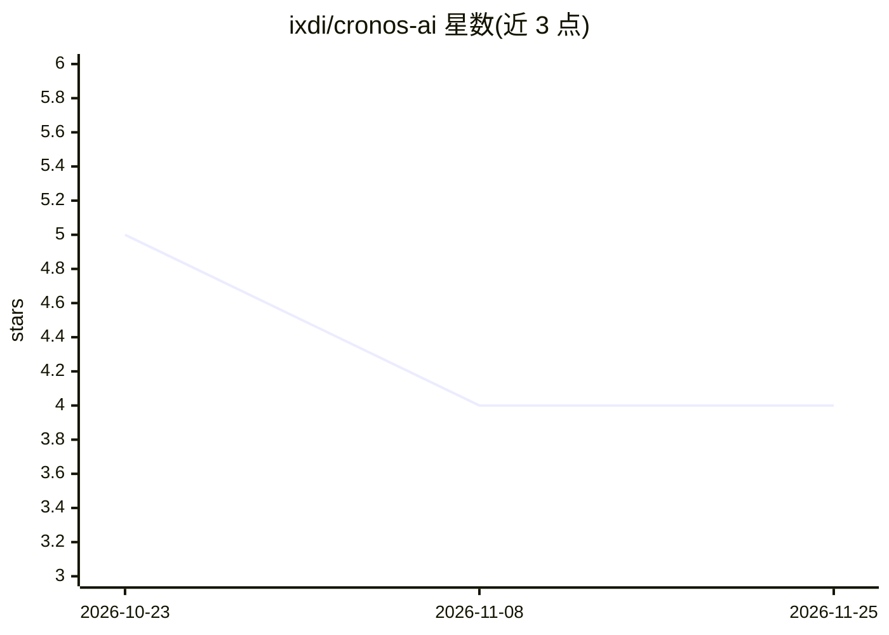

# ixdi/cronos-ai

⭐ 4 · Rust · 推送 2026-10-15 · [GitHub](https://github.com/ixdi/cronos-ai) · [官网](https://ixdi.github.io/cronos-ai/) · 个人维护

**为开发者提供有监督的 agent 辅助软件工厂工作流**

Rust 编写的 TUI/CLI 工具，将项目任务组织为规格、实现、评审、验证、批准、文档与本地合并等步骤的流水线：Rust 持久化任务状态与人审门，一次性 Pi planner 为每步提议 agent，Herdr 并行运行 agent。任务在隔离 Git worktree 中执行，支持并行轨道、优先级排序、写沙箱与失败恢复。仍处于开发阶段，未声明可用于生产；启动时检查依赖但不自动安装。

## 筛选速览

| 维度 | 判定 | 备注 |
|---|---|---|
| AI 角色 | `ai-ecosystem` | LLM/agent 周边工具 |
| 许可风险 | `none` | — |
| 部署形态 | `None` |  |
| 模型依赖 | — | README 未给出锁定关系 |
| 硬件要求 | — | 无带数字的原话,不猜 |
| 安装摩擦 | `medium` | 含编译或系统依赖之一 |
| 成熟度 | `idea` | |

## 能力要点

- 每个任务经过规格、实现、评审、验证、批准、文档、本地合并的结构化步骤
- 人审门要求批准规格与最终代码，附评审视图与 diff
- 每次尝试在隔离 Git worktree 中运行，可本地合并或开 PR
- 支持写沙箱与最多 3 次自动返工

## 适用场景

- 在终端里用 agent 流水线推进功能开发任务
- 对规格与最终代码保留人工批准控制
- 为多个项目维护优先级与依赖感知的任务队列

## 场景标签

`工作流自动化` `编码 Agent` · 领域:效率与自动化

## 证据(README 行号)

> L5: Cronos-AI is a supervised software factory for taking a project task through a structured, agent-assisted workflow.
> L7: It is an opinionated stack with a Rust TUI. Rust owns persisted task state, human approval gates, and the step loop 

## 星数曲线

2026-10-23 5 → 2026-11-25 4（-1）

---
*卡片 v1 · prompt 1.4 · 生成 2026-11-21 · 置信度 high · 依据 README sha `3a25f0446637` · [字段定义](../../DATASET.md)*
