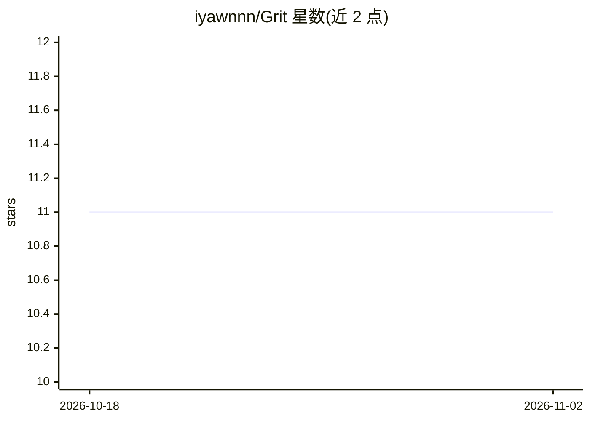

# iyawnnn/Grit

⭐ 11 · Blade · 推送 2026-04-09 · [GitHub](https://github.com/iyawnnn/Grit) · [官网](https://grit.iansebastian.dev/) · 个人维护

**带 AI 能力的求职申请跟踪与面试练习 Web 应用**

面向求职者的 Web 应用：提供职位申请看板（Matched 到 Hired/Rejected 阶段管理）、PDF 简历存储与主简历设置、仪表盘（求职准备度评分、申请趋势与成功率统计）。AI 部分包括：简历与职位描述对比生成匹配报告与改进计划、基于具体职位和简历生成定制模拟面试问题。基于 TALL 栈（Tailwind、Alpine.js、Laravel 8.4、Livewire 3）构建，依赖 Neon 托管 PostgreSQL、Cloudinary 存储、Groq API 提供 AI 能力，使用 Docker 容器化。

## 筛选速览

| 维度 | 判定 | 备注 |
|---|---|---|
| AI 角色 | `ai-enhanced` | 去掉 AI 部分产品仍成立 |
| 许可风险 | `none` | — |
| 部署形态 | `None` |  |
| 模型依赖 | locked-api |  |
| 硬件要求 | — | 无带数字的原话,不猜 |
| 安装摩擦 | `low` | 无编译、无系统依赖或容器化 |
| 成熟度 | — | 结构信号不足 |

## 能力要点

- 职位申请看板按 Matched→Hired/Rejected 阶段管理
- 简历与职位描述对比生成匹配评分与改进计划
- 基于职位描述与用户简历生成定制模拟面试问题
- TALL 栈 + Docker 容器化，数据库查询合并以避免 N+1 问题

## 适用场景

- 集中跟踪和管理我的求职申请进度
- 上传简历并查看与目标职位的匹配度和改进建议
- 针对具体职位做模拟面试练习

## 场景标签

`文档解析` `AI 写作` · 领域:内容生成

## 证据(README 行号)

> L1: # Grit: An AI-Powered Career Assistant
> L13: * **AI Match Reports:** Compare your resume against any job description. Grit provides a match score and an actiona
> L14: * **Mock Interviews:** Practice for the real thing. Grit generates custom interview questions based on the exact jo

## 星数曲线

2026-10-18 11 → 2026-11-02 11（+0）

---
*卡片 v1 · prompt 1.4 · 生成 2026-11-02 · 置信度 high · 依据 README sha `fc7bb5c524ed` · [字段定义](../../DATASET.md)*
