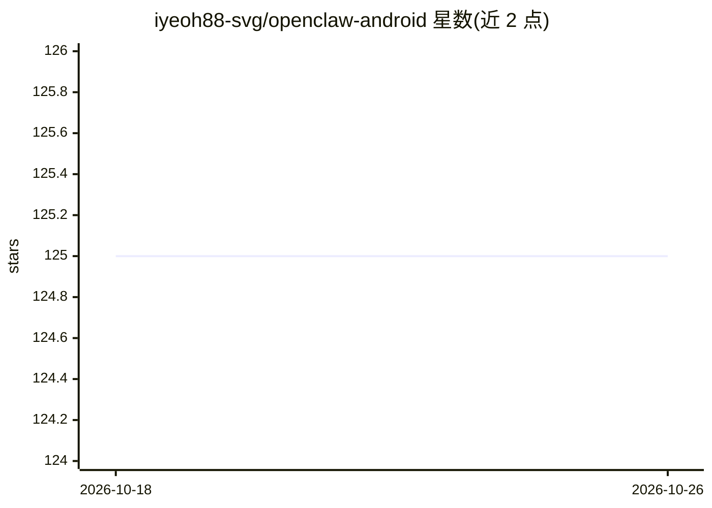

# iyeoh88-svg/openclaw-android

⭐ 125 · Shell · MIT · 推送 2026-04-02 · [GitHub](https://github.com/iyeoh88-svg/openclaw-android) · 个人维护

**在 Android Termux 上自动安装 OpenClaw AI agent 系统的脚本**

社区维护的自动化安装工具，通过 Termux 在 Android 设备上部署 OpenClaw：安装 PRoot-Distro/Debian、创建非 root 专用用户、经 NVM 安装 Node.js v22、从 npm 安装 OpenClaw，并修补 Android 网络问题（Error 13）。一条 curl 命令完成安装，耗时约 5-15 分钟；要求 F-Droid 版 Termux、Android 7+、4GB+ RAM。声明非官方项目，安装器以 MIT 许可发布，OpenClaw 本体另有许可。

## 筛选速览

| 维度 | 判定 | 备注 |
|---|---|---|
| AI 角色 | `ai-ecosystem` | LLM/agent 周边工具 |
| 许可风险 | `permissive` | MIT |
| 部署形态 | `None` |  |
| 模型依赖 | — | README 未给出锁定关系 |
| 硬件要求 | — | 无带数字的原话,不猜 |
| 安装摩擦 | `low` | 无编译、无系统依赖或容器化 |
| 成熟度 | — | 结构信号不足 |

## 能力要点

- 一行 curl 命令完成 5-15 分钟自动安装
- PRoot Debian + 专用 openclaw 非 root 用户架构，支持 Homebrew
- 自动修补 Android 网络错误（Error 13）
- 提供 start-claw/openclaw onboard 等命令别名与配置向导

## 适用场景

- 在 Android 手机上运行 OpenClaw AI agent 系统
- 无需 root 一键搭建 Termux+Debian+Node.js 环境
- 在移动设备上通过 TUI 与 AI agent 交互

## 场景标签

 · 领域:移动端 AI agent 部署工具

## 证据(README 行号)

> L11: > **Automated installer for running OpenClaw AI agent system on Android devices via Termux**
> L95: 7. **Installs OpenClaw** (latest version from npm)

## 星数曲线

2026-10-18 125 → 2026-10-26 125（+0）

---
*卡片 v1 · prompt 1.4 · 生成 2026-10-23 · 置信度 high · 依据 README sha `755928fd12ce` · [字段定义](../../DATASET.md)*
