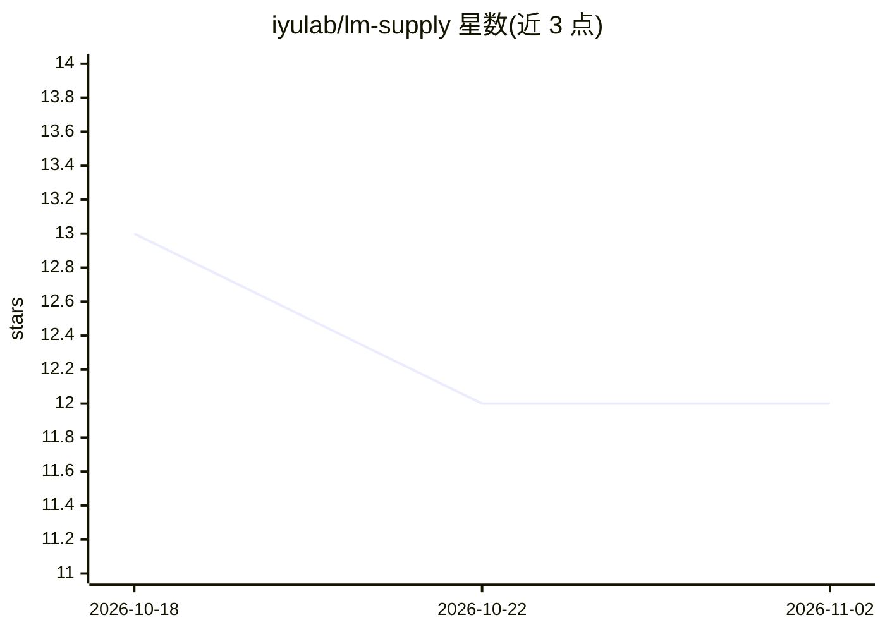

# iyulab/lm-supply

⭐ 12 · C# · MIT · 推送 2026-10-28 · [GitHub](https://github.com/iyulab/lm-supply) · 组织维护

**.NET 本地 AI 推理库：按需下载模型，零内置模型**

面向 .NET 开发者的本地模型推理库，以 NuGet 包族形式提供嵌入、重排、文本生成、图像描述、OCR、目标检测、分割、翻译、语音转写、语音合成、文生图与类型化决策等 10 余种任务接口。核心机制：零内置模型，模型/分词器/运行时组件首次请求时从 HuggingFace 下载并缓存；按平台矩阵自动选择 GGUF(llama.cpp)/ONNX 后端（CUDA/Vulkan/CPU/Metal，VRAM/RAM 感知）。生成器与嵌入器实现 Microsoft.Extensions.AI 的 IChatClient/IEmbeddingGenerator 标准契约。限制：ONNX 生成后端需手动注册；Decider 不支持算术与多步推理。

## 筛选速览

| 维度 | 判定 | 备注 |
|---|---|---|
| AI 角色 | `ai-ecosystem` | LLM/agent 周边工具 |
| 许可风险 | `permissive` | MIT |
| 部署形态 | `None` |  |
| 模型依赖 | local-ok | 支持本地模型 |
| 硬件要求 | `cpu-ok` | |
| 安装摩擦 | `medium` | 含编译或系统依赖之一 |
| 成熟度 | — | 结构信号不足 |

## 能力要点

- 零内置模型，首次请求时按需下载并缓存
- 平台矩阵自动选择 llama.cpp GGUF/ONNX 后端（CUDA/Vulkan/CPU/Metal）
- 14 个 NuGet 包覆盖嵌入/生成/视觉/音频等任务类型
- 实现 Microsoft.Extensions.AI 的 IChatClient 与 IEmbeddingGenerator 契约

## 适用场景

- 在 .NET 应用中两行代码获得本地文本嵌入或生成能力
- 构建本地 RAG 的嵌入与重排组件
- 离线运行 OCR、语音转写、图像描述等视觉/音频任务

## 场景标签

`推理引擎` `OCR` `语音识别` `语音合成` · 领域:内容生成

## 证据(README 行号)

> L25: Your application ships with **zero bundled models**. The base package is tiny. Models, tokenizers, and runtime comp
> L29: First run:  LoadAsync("default") → Downloads model → Caches → Runs inference
> L143: A loaded generator is also a Microsoft.Extensions.AI `IChatClient` (`generator.AsChatClient()`), so a pipeline bui

## 星数曲线

2026-10-18 13 → 2026-11-02 12（-1）

---
*卡片 v1 · prompt 1.4 · 生成 2026-11-01 · 置信度 high · 依据 README sha `af6d19e1f018` · [字段定义](../../DATASET.md)*
