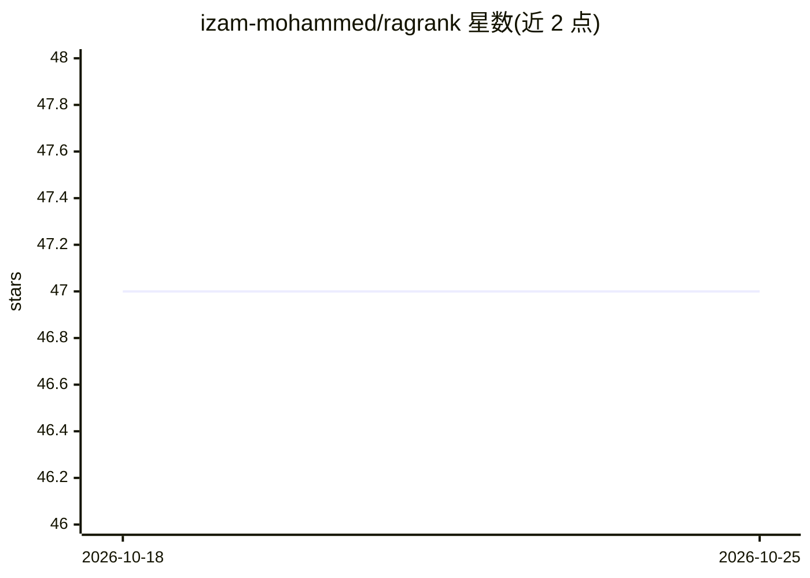

# izam-mohammed/ragrank

⭐ 47 · Python · Apache-2.0 · 推送 2026-10-24 · [GitHub](https://github.com/izam-mohammed/ragrank) · [官网](https://ragrank.readthedocs.io/) · 组织维护

**给 LLM/RAG 开发者的评测工具包：对流水线输出打分**

RAGRank 是用于评估 LLM 应用与 RAG 流水线的 Python 库：输入问题、检索上下文与回答，输出可放入 CI 的数值指标。提供 LLM 判分指标（faithfulness、safety 等 9 项）与免费确定性指标（hit_rate、MRR、ROUGE 等检索与文本匹配类）；支持通过 LiteLLM 接入 ollama 等任意模型，自带 FakeLLM 可在无 API key 下搭建评测流程。附带 pytest 插件、CLI（ragrank eval/compare）、HTML 报告生成、缓存与用量/成本统计。README 首行声明仍在开发中、API 可能变动。

## 筛选速览

| 维度 | 判定 | 备注 |
|---|---|---|
| AI 角色 | `ai-ecosystem` | LLM/agent 周边工具 |
| 许可风险 | `permissive` | Apache-2.0 |
| 部署形态 | `library` | 以包/库形式分发 |
| 模型依赖 | local-ok | 支持本地模型 |
| 硬件要求 | — | 无带数字的原话,不猜 |
| 安装摩擦 | `low` | 无编译、无系统依赖或容器化 |
| 成熟度 | `idea` | |

## 能力要点

- LLM 判分指标与免费确定性指标（检索排序、文本匹配）两套体系
- LiteLLM 支持任意模型（如 ollama/llama3），FakeLLM 免 key 运行
- pytest 插件与 CLI 支持 CI 门禁（阈值断言、退出码区分）
- 实验对比 compare 与判分-人工标注一致性校验（align/bias）

## 适用场景

- 在 CI 中对 RAG 管道做回归测试与阈值门禁
- 评估回答的忠实度与上下文相关性并定位坏行
- 对比流水线 v1/v2 变化是否显著
- 无 API key 时先离线搭好评测流程再接入真实模型

## 场景标签

`模型评测` · 领域:评测与运维

## 证据(README 行号)

> L27: ragrank scores your RAG pipeline so you don't have to squint at outputs and go "yeah, that
> L63: from ragrank import evaluate
> L104: **judged** ~ these cost an llm call

## 星数曲线

2026-10-18 47 → 2026-10-25 47（+0）

---
*卡片 v1 · prompt 1.4 · 生成 2026-10-25 · 置信度 high · 依据 README sha `e2bd77f24ad6` · [字段定义](../../DATASET.md)*
