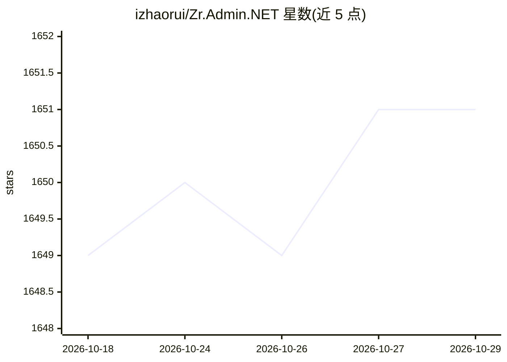

# izhaorui/Zr.Admin.NET

⭐ 1,651 · C# · MIT · 推送 2026-10-22 · [GitHub](https://github.com/izhaorui/Zr.Admin.NET) · [官网](http://www.izhaorui.cn) · 个人维护 · 中文 README

**基于 .NET8+Vue 的 RBAC 权限管理后台框架**

基于 .NET8 + SqlSugar + Vue2/Vue3/uniapp 的前后端分离通用权限管理框架（RBAC），面向有一定 .NET 和 Vue 基础的开发者。内置 SaaS 多租户（一租户一库）、可视化审批流引擎（动态表单、条件/并行网关、加签转办等）、一键代码生成、Quartz.NET 任务调度、Redis 缓存、SignalR 实时通知与接口限流等。后端核心框架中列有 AI 组件（AI 助手与治理），数据库初始化通过 dotnet run CLI 命令完成。

## 筛选速览

| 维度 | 判定 | 备注 |
|---|---|---|
| AI 角色 | `ai-enhanced` | 去掉 AI 部分产品仍成立 |
| 许可风险 | `permissive` | MIT |
| 部署形态 | `None` |  |
| 模型依赖 | — | README 未给出锁定关系 |
| 硬件要求 | — | 无带数字的原话,不猜 |
| 安装摩擦 | `medium` | 含编译或系统依赖之一 |
| 成熟度 | — | 结构信号不足 |

## 能力要点

- DB-per-tenant SaaS 多租户方案（独立库+套餐菜单授权）
- 可视化审批流引擎：动态表单、条件/并行网关、加签/转办/委托代审
- 代码生成器一键生成前后端代码（.cs/.vue/.js/.sql/uniapp）
- Quartz.NET 任务调度 + Redis 缓存 + SignalR 实时通知

## 适用场景

- 我需要一个开箱即用的企业后台管理系统基座
- 我要搭建带多租户与套餐授权的 SaaS 平台
- 我要为组织搭建可视化审批流与定时任务系统

## 场景标签

 · 领域:企业后台管理系统/快速开发框架

## 证据(README 行号)

> L17: - 基于.NET8 实现的通用权限管理平台（RBAC 模式）。整合最新技术高效快速开发，前后端分离模式，开箱即用。
> L77: - 核心框架：.Net8.0 + Web API + sqlsugar + swagger + signalR + IpRateLimit + Quartz.net + Redis + MiniExcel + AI
> L86: - 多 租 户：内置完整 SaaS 多租户方案（DB-per-tenant 独立数据库 + 套餐菜单授权），详见下方 SaaS 多租户

## 星数曲线

2026-10-18 1,649 → 2026-10-29 1,651（+2）

---
*卡片 v1 · prompt 1.4 · 生成 2026-10-21 · 置信度 high · 依据 README sha `5e693c3638b9` · [字段定义](../../DATASET.md)*
