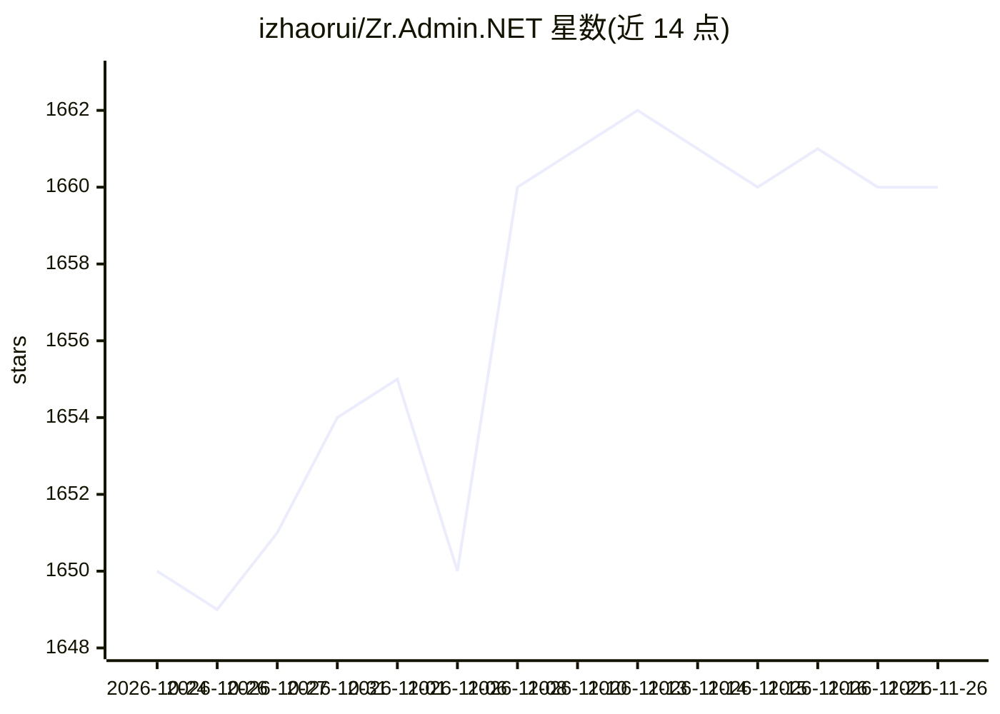

# izhaorui/Zr.Admin.NET

⭐ 1,660 · C# · MIT · 推送 2026-11-18 · [GitHub](https://github.com/izhaorui/Zr.Admin.NET) · [官网](http://www.izhaorui.cn) · 个人维护 · 中文 README

**.NET+Vue3 前后端分离的 RBAC 权限管理与后台框架**

基于 .NET（README 标注 .NET 10）+ SqlSugar + Vue3 的通用权限管理框架，覆盖用户/角色/菜单等 RBAC 模块、SaaS 多租户（一租户一库）、可视化工作流、Quartz.NET 任务调度、代码生成、Redis 缓存、SignalR 通知、对象存储与商城模块。内置 AI 功能：办公助手、业务页 AI、工作流 AI 与图表管道，通过 OpenAI 兼容协议接入模型，并配套限额、用量统计等治理机制。面向有 .NET 和 Vue 基础的开发人员。

## 筛选速览

| 维度 | 判定 | 备注 |
|---|---|---|
| AI 角色 | `ai-enhanced` | 去掉 AI 部分产品仍成立 |
| 许可风险 | `permissive` | MIT |
| 部署形态 | `None` |  |
| 模型依赖 | local-ok | 支持本地模型 |
| 硬件要求 | — | 无带数字的原话,不猜 |
| 安装摩擦 | `medium` | 含编译或系统依赖之一 |
| 成熟度 | — | 结构信号不足 |

## 能力要点

- 内置 SaaS 多租户（DB-per-tenant 独立数据库）与套餐菜单授权
- 内置 AI 助手/业务页 AI/工作流 AI，走 OpenAI 兼容协议接入模型
- 可视化工作流引擎与 Quartz.NET 任务调度、一键前后端代码生成
- 附商城模块（商品/SKU/订单/售后/微信支付）

## 适用场景

- 快速搭建带 RBAC 权限的企业后台管理系统
- 需要多租户数据隔离的 SaaS 类业务系统
- 给现有后台补充 AI 助手与审批流能力

## 场景标签

`工作流自动化` `代码生成` `AI 助手` · 领域:效率与自动化

## 证据(README 行号)

> L18: - 基于 .NET 10 实现的通用权限管理平台（RBAC 模式）。整合最新技术高效快速开发，前后端分离模式，跨平台、开箱即用。
> L128: 29. AI 助手：内置全局办公助手（对话/工具编排/发图）、业务页 AI、工作流 AI 与安全图表能力，并配套 AI 治理（多级限额、模型价格、用量统计、配置检查与探活）。
> L201: 内置开箱即用的 AI 能力，助手、业务页、工作流共用同一套 LLM 客户端与「AI 治理」，统一管控额度、成本与审计；模型走 OpenAI 兼容协议（`openai` / `deepseek` / `qwen` / `ollam

## 星数曲线

2026-10-24 1,650 → 2026-11-26 1,660（+10）

---
*卡片 v1 · prompt 1.4 · 生成 2026-11-23 · 置信度 high · 依据 README sha `c281ec875561` · [字段定义](../../DATASET.md)*
