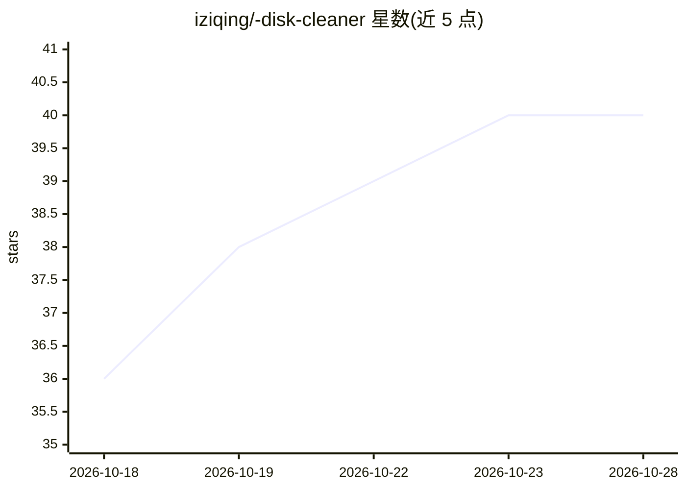

# iziqing/-disk-cleaner

⭐ 40 · Python · MIT · 推送 2026-07-17 · [GitHub](https://github.com/iziqing/-disk-cleaner) · 个人维护 · 中文 README

**给普通用户的 Claude Code 磁盘清理技能：WizTree 扫描 + AI 分析**

以 Agent Skill（SKILL.md + Python 脚本）形式安装到 Claude Code 的 Windows C 盘清理工具：调用 WizTree MFT 扫描导出磁盘占用数据，由 AI 按高/中/低优先级分类可清理目录并生成清理脚本。提供两种模式：给管理员权限则扫描→分析→清理全自动（方案需确认），不给权限则 AI 分析后人工执行。清理前自动备份可回滚，声明永不删除系统文件与用户数据，并列出安全红线目录。需自备 WizTree、Claude Code CLI 与 Python 3.x。

## 筛选速览

| 维度 | 判定 | 备注 |
|---|---|---|
| AI 角色 | `ai-native` | 本体是模型或模型工具 |
| 许可风险 | `permissive` | MIT |
| 部署形态 | `desktop` | 安装包/桌面程序 |
| 模型依赖 | — | README 未给出锁定关系 |
| 硬件要求 | — | 无带数字的原话,不猜 |
| 安装摩擦 | `low` | 无编译、无系统依赖或容器化 |
| 成熟度 | — | 结构信号不足 |

## 能力要点

- WizTree MFT 扫描秒级导出磁盘占用数据
- AI 按高/中/低三级优先级生成清理建议与脚本
- 清理前自动备份，支持一键恢复
- 标准 SKILL.md 结构，用户级/项目级两种安装方式

## 适用场景

- C 盘空间不足时让 AI 分析哪些缓存可以安全清理
- 普通权限模式下由 AI 生成脚本、人工确认后执行
- 借助清理规则知识库避开系统关键目录

## 场景标签

 · 领域:系统工具/AI Agent 技能

## 证据(README 行号)

> L10: 利用 **WizTree 快速扫描** + **AI 智能分析**，高效清理磁盘空间。
> L129: 🤖 AI：分析 + 生成清理脚本
> L183: /clean-c-drive

## 星数曲线

2026-10-18 36 → 2026-10-28 40（+4）

---
*卡片 v1 · prompt 1.4 · 生成 2026-10-25 · 置信度 high · 依据 README sha `c308c1d2339a` · [字段定义](../../DATASET.md)*
