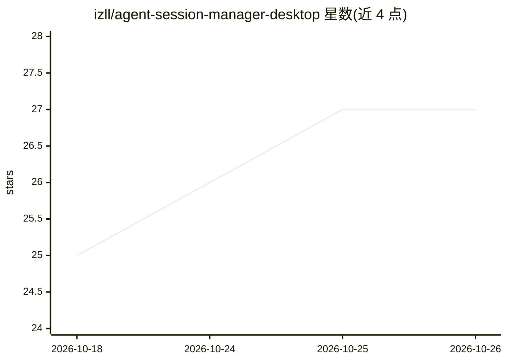

# izll/agent-session-manager-desktop

⭐ 27 · Go · MIT · 推送 2026-10-06 · [GitHub](https://github.com/izll/agent-session-manager-desktop) · [官网](https://github.com/izll/agent-session-manager-desktop/releases) · 个人维护

**AI 编码 agent 多会话桌面管理器：一个窗口跑 Claude/Codex/Gemini 等多个 agent**

基于 Wails(Go)+Svelte+xterm.js 的桌面 GUI，是 izll/agent-session-manager TUI 的图形版。每个 agent 会话运行在 tmux（Linux/macOS）或 psmux（Windows）多路复用器中，关闭窗口或重启应用后会话仍在，可一键重连。支持 Claude、Codex、Gemini、Aider、Amazon Q、OpenCode 等作为会话类型。提供等待提示（⏳计数、桌面与 ntfy 手机推送）、Claude/Codex 用量窗口显示、Git 状态/diff 审查与单 hunk 回滚、全局历史搜索、会话模板、远程服务器上运行会话等。tmux 缺失时应用可代为安装。

## 筛选速览

| 维度 | 判定 | 备注 |
|---|---|---|
| AI 角色 | `ai-ecosystem` | LLM/agent 周边工具 |
| 许可风险 | `permissive` | MIT |
| 部署形态 | `desktop` | 安装包/桌面程序 |
| 模型依赖 | locked-api |  |
| 硬件要求 | — | 无带数字的原话,不猜 |
| 安装摩擦 | `low` | 无编译、无系统依赖或容器化 |
| 成熟度 | — | 结构信号不足 |

## 能力要点

- 会话驻留 tmux/psmux，关窗/重启/换机后可重连
- 等待中的 agent 提示：⏳计数、桌面通知与 ntfy 手机推送
- 项目面板：分组会话、每仓库 Git 状态、Claude/Codex 用量窗口
- diff 逐文件审查与单 hunk 回滚、全局跨会话历史搜索

## 适用场景

- 同时跑多个 AI 编码 agent 并在标签页间切换管理
- 在手机上接收 agent 等待输入的推送并及时回复
- 审查 agent 产生的 Git 改动并回滚不需要的部分
- 在远程服务器上运行 agent 会话并从桌面查看

## 场景标签

 · 领域:开发者工具/AI agent 管理

## 证据(README 行号)

> L5: **Run a whole team of AI coding agents from one window.**
> L6: Claude, Codex, Gemini, Aider and more — each in its own live terminal, all
> L61: - **Many agents, your choice** — Claude, Gemini, Aider, Codex, Amazon Q,

## 星数曲线

2026-10-18 25 → 2026-10-26 27（+2）

---
*卡片 v1 · prompt 1.4 · 生成 2026-10-26 · 置信度 high · 依据 README sha `290a22c9187b` · [字段定义](../../DATASET.md)*
