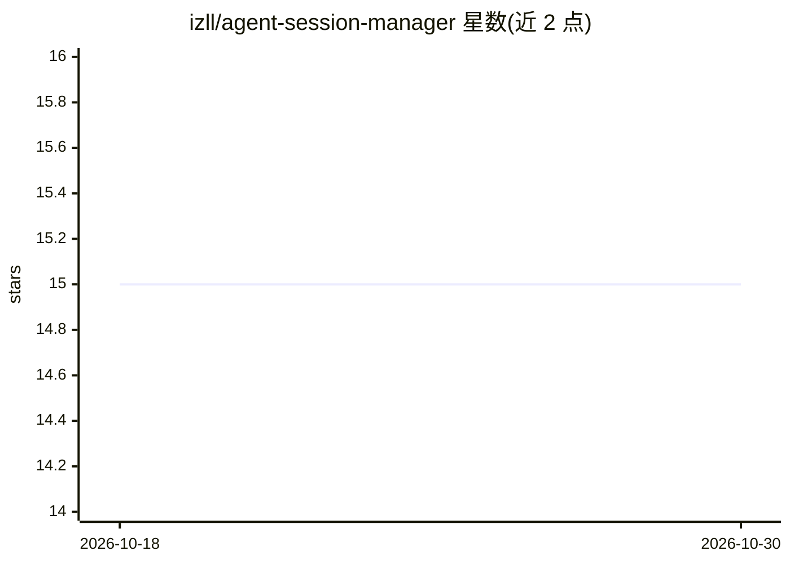

# izll/agent-session-manager

⭐ 15 · Go · MIT · 推送 2026-09-25 · [GitHub](https://github.com/izll/agent-session-manager) · [官网](https://github.com/izll/agent-session-manager/releases) · 个人维护

**管理多个 AI 编程 agent CLI 会话的终端 TUI 工具**

基于 Go + Bubble Tea 构建的 tmux 终端会话管理器，用于同时运行和管理多个 AI 编程助手 CLI 会话，支持 Claude Code、Gemini CLI、Aider、OpenAI Codex、Amazon Q、OpenCode 及自定义命令。提供项目/工作区隔离、多标签会话、并行会话、实时预览、会话恢复、Claude 会话分叉、diff 视图、全局历史搜索与内置自更新等功能。前置依赖为 tmux（Linux/macOS）或 psmux（Windows），需至少安装一个 AI CLI 工具。另有独立桌面版 ASMGR Desktop（Wails + Svelte）。

## 筛选速览

| 维度 | 判定 | 备注 |
|---|---|---|
| AI 角色 | `ai-ecosystem` | LLM/agent 周边工具 |
| 许可风险 | `permissive` | MIT |
| 部署形态 | `desktop` | 安装包/桌面程序 |
| 模型依赖 | locked-api |  |
| 硬件要求 | — | 无带数字的原话,不猜 |
| 安装摩擦 | `low` | 无编译、无系统依赖或容器化 |
| 成熟度 | — | 结构信号不足 |

## 能力要点

- 支持 6 种 AI 编程 CLI 及自定义命令的多会话管理
- 项目/工作区隔离、多标签（Agent/终端混合）与并行会话
- 会话恢复（Claude/Gemini/Codex/OpenCode/Amazon Q）与 Claude 会话分叉
- 内置自更新，覆盖 Homebrew/deb/rpm/安装脚本途径

## 适用场景

- 在同一终端并行运行多个 AI 编程 agent 处理不同任务
- 按项目组织会话并快速恢复历史对话
- 并排对比两个会话输出、查看会话 git diff

## 场景标签

 · 领域:开发者工具/终端会话管理

## 证据(README 行号)

> L5:  A powerful terminal UI (TUI) application for managing multiple AI coding assistant CLI sessions using tmux.
> L32: - **Multi-Agent Support** - Run Claude, Gemini, Aider, Codex, Amazon Q, OpenCode, or custom commands

## 星数曲线

2026-10-18 15 → 2026-10-30 15（+0）

---
*卡片 v1 · prompt 1.4 · 生成 2026-10-30 · 置信度 high · 依据 README sha `20bb073d5d0d` · [字段定义](../../DATASET.md)*
