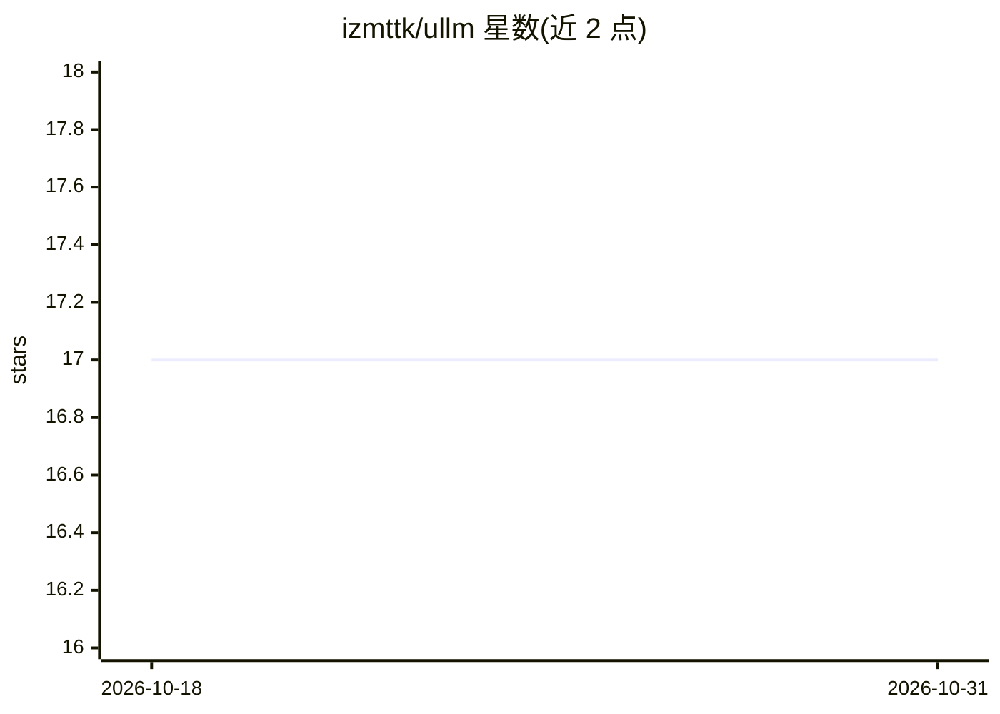

# izmttk/ullm

⭐ 17 · Python · MIT · 推送 2026-03-29 · [GitHub](https://github.com/izmttk/ullm) · 个人维护 · 中文 README

**从零构建的轻量 LLM 推理引擎，带 Radix Cache 与并行支持**

受 nano-vllm 启发、面向学习与构建的轻量 LLM 推理框架：架构组织参照 vLLM v1，KV 缓存采用 SGLang 的 Radix Cache 实现。功能包括 FCFS 调度与持续批处理、OpenAI 兼容 API 服务、基于 Radix Tree 的 Prefix Caching、FlashInfer 实现的 Flash Attention、张量并行与流水线并行、CUDA Graph（仅 Decoding 阶段）及完全异步调度。通过 git clone 后 pip install -e . 安装，提供 API 服务与离线推理两种用法；README 含与 vLLM 的吞吐量基准对比，开发仍在进行中。

## 筛选速览

| 维度 | 判定 | 备注 |
|---|---|---|
| AI 角色 | `ai-ecosystem` | LLM/agent 周边工具 |
| 许可风险 | `permissive` | MIT |
| 部署形态 | `library` | 以包/库形式分发 |
| 模型依赖 | — | README 未给出锁定关系 |
| 硬件要求 | — | 无带数字的原话,不猜 |
| 安装摩擦 | `medium` | 含编译或系统依赖之一 |
| 成熟度 | — | 结构信号不足 |

## 能力要点

- 基于 Radix Tree 的 Prefix Caching 与 FCFS 持续批处理调度
- 张量并行、流水线并行与完全异步调度
- OpenAI 兼容 API 服务与离线推理两种使用方式
- CUDA Graph 支持（仅 Decoding 阶段）

## 适用场景

- 本地或服务器上运行 LLM 推理服务（OpenAI 兼容 API）
- 学习 LLM 推理引擎的内部实现（PagedAttention、调度、并行）
- 通过 TP/PP 在多卡环境部署模型推理

## 场景标签

`推理引擎` · 领域:训练与推理

## 证据(README 行号)

> L3: μLLM: A lightweight vLLM-like LLM inference engine with radix-tree based KV cache, and more.
> L5: 该项目受 nano-vllm 启发，提供一个从零开始构建的 LLM 推理框架

## 星数曲线

2026-10-18 17 → 2026-10-31 17（+0）

---
*卡片 v1 · prompt 1.4 · 生成 2026-10-29 · 置信度 high · 依据 README sha `1b76ab9b9ae1` · [字段定义](../../DATASET.md)*
