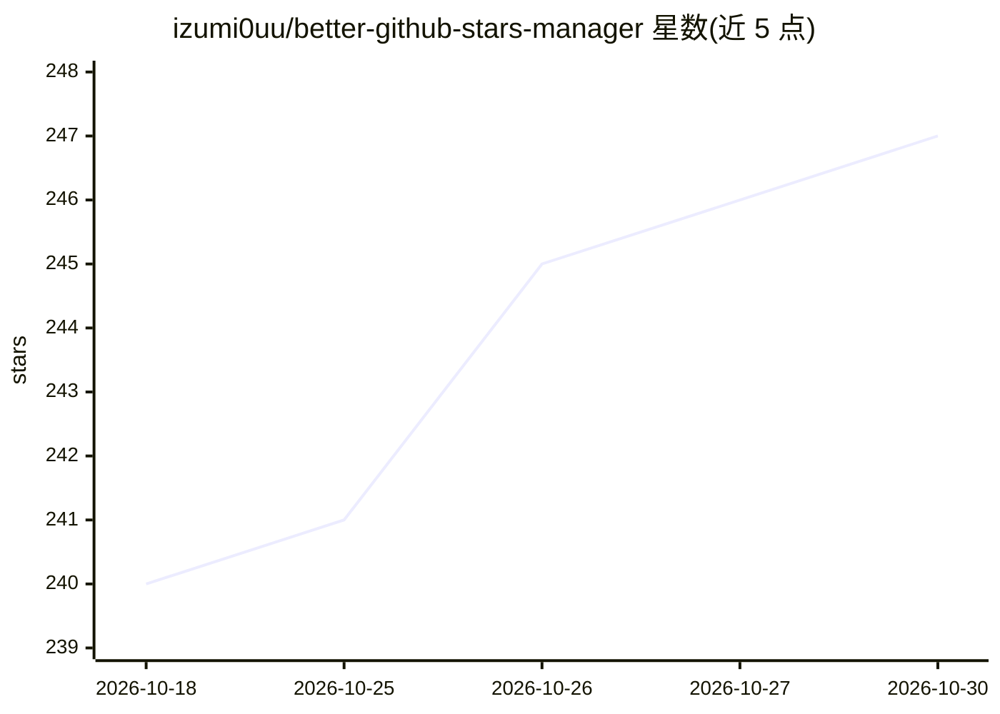

# izumi0uu/better-github-stars-manager

⭐ 247 · TypeScript · MIT · 推送 2026-10-01 · [GitHub](https://github.com/izumi0uu/better-github-stars-manager) · [官网](https://betterstars.app) · 个人维护 · 中文 README

**管理 GitHub Stars 的 Chrome 扩展：搜索、标签、笔记与筛选**

基于 Manifest V3 的浏览器扩展，直接挂载在 GitHub Stars 页面：搜索仓库名/描述/topics/笔记，按语言、标签、收藏、Archived 等组合筛选，支持自定义标签、本地笔记、Auto Tags、面板列布局自定义与虚拟化渲染（可处理几千条记录）。可选功能包括 Watch 通知工作区、Following 动态、For You 本地确定性推荐、Secret Gist 同步，以及 Cubby AI 助手（总结资料库、比较项目、提出标签建议，写入前需用户 Apply）。数据默认存本地 IndexedDB，需配置 GitHub Classic PAT。

## 筛选速览

| 维度 | 判定 | 备注 |
|---|---|---|
| AI 角色 | `ai-enhanced` | 去掉 AI 部分产品仍成立 |
| 许可风险 | `permissive` | MIT |
| 部署形态 | `library` | 以包/库形式分发 |
| 模型依赖 | — | README 未给出锁定关系 |
| 硬件要求 | — | 无带数字的原话,不猜 |
| 安装摩擦 | `low` | 无编译、无系统依赖或容器化 |
| 成熟度 | — | 结构信号不足 |

## 能力要点

- Stars 页面内搜索、组合筛选、标签/笔记/Auto Tags 与自定义列布局
- 虚拟化渲染支持几百到几千条记录，增量 Sync 与 Full Sync
- Cubby AI 助手：只读分析后经用户 Review/Apply 才写入标签
- 本地优先：无后端/代理/遥测，Token 加密存 chrome.storage.local

## 适用场景

- star 数量多到记不住时，搜索和筛选找到收藏的项目
- 给收藏的仓库打标签、写笔记并同步到 Secret Gist
- 在一个页面查看关注的人 star 了什么、获取仓库推荐
- 让 AI 助手归纳资料库并给出标签建议后再确认应用

## 场景标签

`知识库管理` · 领域:知识与检索

## 证据(README 行号)

> L146: ### 让 Cubby 帮你整理 stars 仓库 Cubby 正在工作
> L185: Better GitHub Stars Manager 是 Stars 页面的增强层，不是另一个平台：

## 星数曲线

2026-10-18 240 → 2026-10-30 247（+7）

---
*卡片 v1 · prompt 1.4 · 生成 2026-10-22 · 置信度 high · 依据 README sha `9616a8a20836` · [字段定义](../../DATASET.md)*
