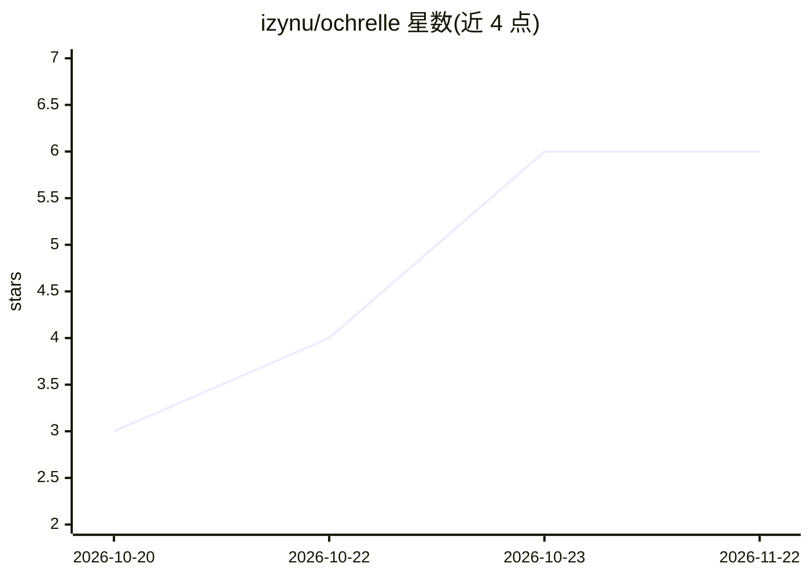

# izynu/ochrelle

⭐ 6 · TypeScript · MIT · 推送 2026-10-20 · [GitHub](https://github.com/izynu/ochrelle) · [官网](https://izynu.github.io/ochrelle/) · 个人维护

**为 AI 编码 agent 提供 28 个界面艺术方向技能的 markdown 知识库**

Ochrelle 以 Agent Skills 格式（SKILL.md + references/）打包的界面设计知识库：1 个主控技能通过访谈产品上下文（受众、平台、品牌温度）比较并选定视觉风格，27 个专家技能分别覆盖拟物、新拟态、玻璃拟态、粗野主义等风格，给出设计令牌、组件配方、反模式清单与 WCAG 2.2 AA 可访问性约束。内容为纯 markdown 与 Python 校验脚本，带 install.sh 复制安装器，支持 Claude Code、Cursor、Codex、Gemini CLI 等读取技能目录的 agent。

## 筛选速览

| 维度 | 判定 | 备注 |
|---|---|---|
| AI 角色 | `ai-knowledge` | 知识聚合/清单类 |
| 许可风险 | `permissive` | MIT |
| 部署形态 | `None` |  |
| 模型依赖 | — | README 未给出锁定关系 |
| 硬件要求 | — | 无带数字的原话,不猜 |
| 安装摩擦 | `low` | 无编译、无系统依赖或容器化 |
| 成熟度 | — | 结构信号不足 |

## 能力要点

- 1 个主控技能负责风格选型并路由到 27 个专家技能
- 每个技能含 style-guide.md（令牌、组件配方、反模式、WCAG 2.2 AA 说明）
- scripts/install.sh 无依赖安装器，支持 --only 安装单个技能
- 渐进式披露：references/ 按需读取以节省上下文

## 适用场景

- 让编码 agent 生成 UI 时先做风格决策再执行
- 为产品选定并落地某一具体视觉风格（如 bento grid、新拟态）
- 用 WCAG 2.2 AA 清单校验表达性风格的对比度风险
- 在 PR 中以普通文档方式评审设计规范

## 场景标签

`提示工程` · 领域:Agent 开发

## 证据(README 行号)

> L20: Ochrelle is an open-source ecosystem of Agent Skills for design intelligence: one master skill that reasons about *
> L27: |**Format**|Agent Skills: a `SKILL.md` with YAML frontmatter plus supporting `references/` files per skill|
> L97: Every skill directory is self-contained: a `SKILL.md` (frontmatter + workflow) and at least a `references/style-gui

## 星数曲线

2026-10-20 3 → 2026-11-22 6（+3）

---
*卡片 v1 · prompt 1.4 · 生成 2026-11-20 · 置信度 high · 依据 README sha `6b9d3d19e694` · [字段定义](../../DATASET.md)*
