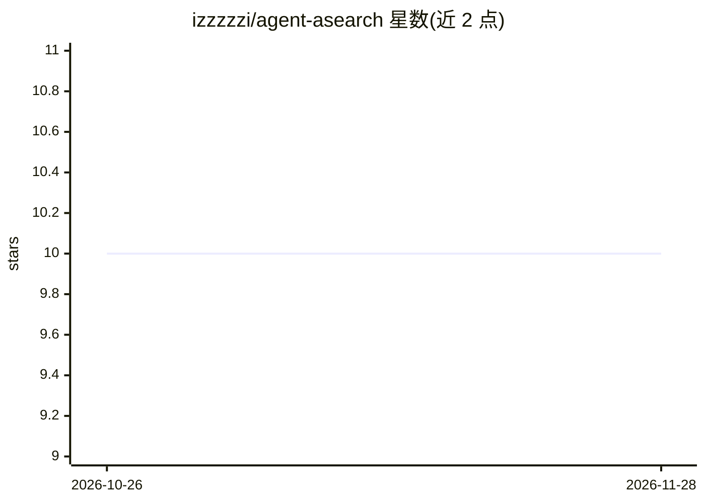

# izzzzzi/agent-asearch

⭐ 10 · Go · MIT · 推送 2026-06-08 · [GitHub](https://github.com/izzzzzi/agent-asearch) · 个人维护

**面向 LLM agent 的多源搜索 CLI，一条命令查 18 个来源**

Go 编写的单二进制命令行工具，供 LLM agent 调用：并行检索 web、Hacker News、Reddit、GitHub、YouTube、X/Twitter 及 Tavily、Exa、Brave 等 API。采用会话式工作流：`open` 返回 sid 与 next_commands，先输出紧凑元数据，agent 再分页读取所需页面，以减少上下文占用与 token 消耗；结果以稳定 JSON 返回。5 个来源无需 API key；Reddit/YouTube 需浏览器 cookie，web 无 key 时仅显示获取 key 的指引。

## 筛选速览

| 维度 | 判定 | 备注 |
|---|---|---|
| AI 角色 | `ai-ecosystem` | LLM/agent 周边工具 |
| 许可风险 | `permissive` | MIT |
| 部署形态 | `self-host` | docker 或自建部署 |
| 模型依赖 | — | README 未给出锁定关系 |
| 硬件要求 | — | 无带数字的原话,不猜 |
| 安装摩擦 | `low` | 无编译、无系统依赖或容器化 |
| 成熟度 | — | 结构信号不足 |

## 能力要点

- 一条命令并行检索 18 个来源，JSON 输出便于 agent 解析
- 会话式工作流：sid + next_commands，先元数据后分页读页以节省 token
- hn、reddit、github、jina、web 等 5 个来源无需 API key
- Go 单二进制，唯一代码依赖为 Cobra，自动更新与 shell completion

## 适用场景

- 给 Codex/Claude Code 等 terminal agent 注入统一的网络搜索指令
- 写 agent 工具时需要稳定 JSON 的多源搜索结果
- 无 API key 环境下先做免费来源（HN/GitHub/Jina）检索
- 按来源过滤与分页浏览，控制 agent 上下文长度

## 场景标签

`语义搜索` · 领域:知识与检索

## 证据(README 行号)

> L10: Поисковый CLI для LLM-агентов. Одна команда — 18 источников.
> L12: `asearch` ищет одновременно в вебе, Hacker News, Reddit, GitHub, YouTube, X/Twitter и коде, а также через Tavily, E
> L89: - `asearch prompt` — инструкция для LLM-агента.

## 星数曲线

2026-10-26 10 → 2026-11-28 10（+0）

---
*卡片 v1 · prompt 1.4 · 生成 2026-11-19 · 置信度 mid · 依据 README sha `ebcd92dd8b45` · [字段定义](../../DATASET.md)*
