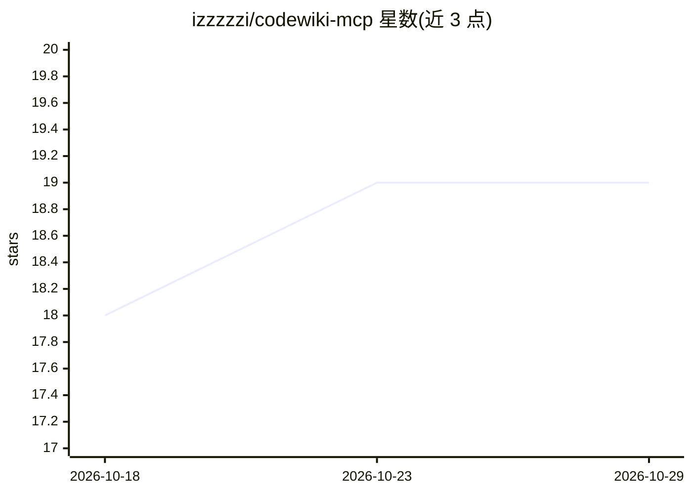

# izzzzzi/codewiki-mcp

⭐ 19 · TypeScript · MIT · 推送 2026-06-22 · [GitHub](https://github.com/izzzzzi/codewiki-mcp) · 个人维护 · 中文 README

**连接 AI 助手到 codewiki.google 的 MCP 服务器，查询开源仓库文档**

TypeScript 实现的 Model Context Protocol 服务器，向 AI 助手开放 codewiki.google（为 GitHub 仓库生成 wiki 文档的服务）的三个工具：搜索已索引仓库、获取完整/结构化 wiki 文档、对仓库进行带会话历史的自然语言问答。数据经 Google batchexecute RPC 与 codewiki.google 通信；支持 wink-nlp 将自然语言输入解析为 owner/repo（经 GitHub Search API）。提供 stdio/HTTP/SSE 三种传输、Docker 构建与 npx 直接运行，附 Cursor/Claude Desktop/Claude Code/Windsurf/VS Code 等客户端配置说明。

## 筛选速览

| 维度 | 判定 | 备注 |
|---|---|---|
| AI 角色 | `ai-ecosystem` | LLM/agent 周边工具 |
| 许可风险 | `permissive` | MIT |
| 部署形态 | `self-host` | docker 或自建部署 |
| 模型依赖 | — | README 未给出锁定关系 |
| 硬件要求 | — | 无带数字的原话,不猜 |
| 安装摩擦 | `low` | 无编译、无系统依赖或容器化 |
| 成熟度 | — | 结构信号不足 |

## 能力要点

- 三个 MCP 工具：搜索仓库、获取 wiki 文档、自然语言问答（支持会话历史）
- wink-nlp 自然语言解析仓库名，经 GitHub Search API 解析为 owner/repo
- 支持 stdio/Streamable HTTP/SSE 三种传输与 Docker 多阶段构建
- 5xx 错误指数退避重试，响应含字节数与耗时元数据

## 适用场景

- 在 Cursor/Claude 等 MCP 客户端中查询开源仓库的 AI 生成文档
- 以自然语言向特定仓库提问并获取带上下文的回答
- 搜索 codewiki.google 已索引的开源仓库

## 场景标签

`文档问答` · 领域:知识与检索

## 证据(README 行号)

> L15: *MCP server that connects any AI assistant to codewiki.google — AI-generated wiki documentation for open-source rep
> L19: **codewiki-mcp** is a Model Context Protocol server that gives AI assistants access to **codewiki.google** — a serv
> L240: AI Assistant → MCP protocol → codewiki-mcp → HTTPS → codewiki.google

## 星数曲线

2026-10-18 18 → 2026-10-29 19（+1）

---
*卡片 v1 · prompt 1.4 · 生成 2026-10-28 · 置信度 high · 依据 README sha `1784fb3b9f7a` · [字段定义](../../DATASET.md)*
