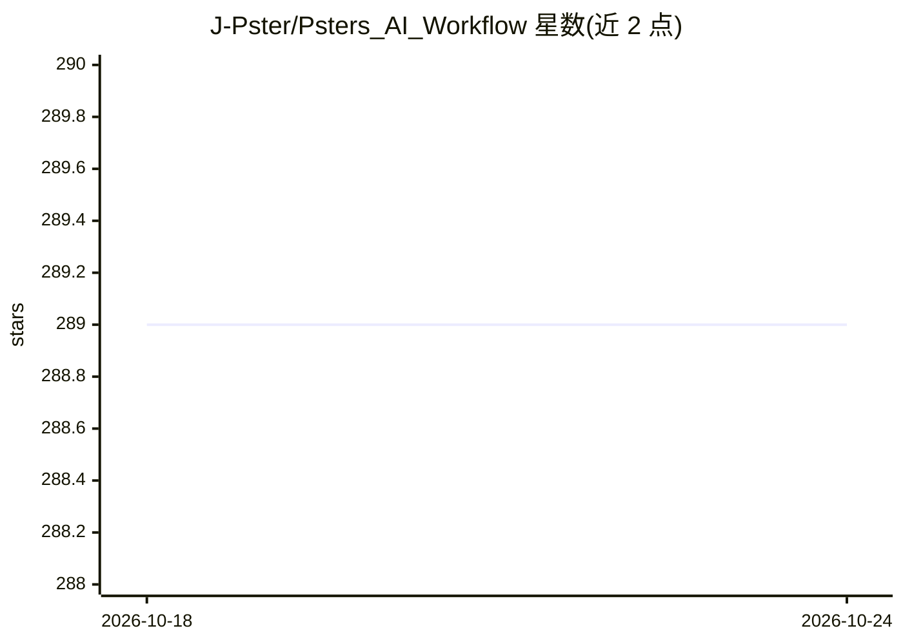

# J-Pster/Psters_AI_Workflow

⭐ 289 · JavaScript · MIT · 推送 2026-03-18 · [GitHub](https://github.com/J-Pster/Psters_AI_Workflow) · [官网](https://github.com/J-Pster/Psters_AI_Workflow/wiki) · 个人维护 · 中文 README

**面向软件团队的自文档化、模型无关 AI 开发工作流插件**

以 Cursor 插件形式提供的 AI 编码工作流：包含 20 个命令、45 个 agent、4 个 hook、8 条规则、17 个 skill，通过 /pwf-brainstorm 到 /pwf-plan 再到 /pwf-work-plan 的分阶段流程执行开发任务。开发者显式选择路径，AI 在结构化约束下执行；实现前读取项目文档、执行中自动生成与维护文档，以此降低幻觉并保持交付可预测。适用于新旧项目、任意框架与语言，通过本地脚本安装，暂未上架 Marketplace。

## 筛选速览

| 维度 | 判定 | 备注 |
|---|---|---|
| AI 角色 | `ai-ecosystem` | LLM/agent 周边工具 |
| 许可风险 | `permissive` | MIT |
| 部署形态 | `None` |  |
| 模型依赖 | — | README 未给出锁定关系 |
| 硬件要求 | — | 无带数字的原话,不猜 |
| 安装摩擦 | `low` | 无编译、无系统依赖或容器化 |
| 成熟度 | `idea` | |

## 能力要点

- 20 个命令 / 45 个 agent / 4 个 hook / 8 条规则 / 17 个 skill 组成的模块化结构
- brainstorm→plan→work-plan 分阶段流程，含 checklist/clarify/analyze 质量门
- 实现前读取文档、执行中自动生成维护文档，文档作为项目记忆
- 模型无关，适用于任意项目、框架与语言

## 适用场景

- 在新项目上初始化结构化 AI 开发工作流与文档基线
- 为已有项目补建文档并按阶段规划实施任务
- 团队希望以显式命令控制 AI 执行路径以降低幻觉

## 场景标签

`编码 Agent` · 领域:编码与开发

## 证据(README 行号)

> L15: An auto-documenting, model-agnostic AI workflow for any project, framework, and language. It reduces hallucination 
> L36: This workflow prioritizes predictability: commands do not autonomously pick your path.

## 星数曲线

2026-10-18 289 → 2026-10-24 289（+0）

---
*卡片 v1 · prompt 1.4 · 生成 2026-10-22 · 置信度 high · 依据 README sha `988e3ae89e19` · [字段定义](../../DATASET.md)*
