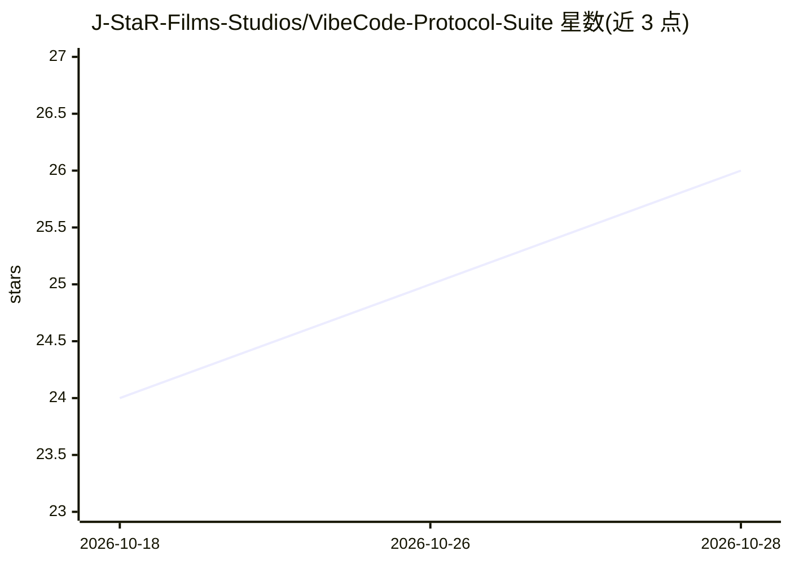

# J-StaR-Films-Studios/VibeCode-Protocol-Suite

⭐ 26 · JavaScript · ISC · 推送 2026-10-17 · [GitHub](https://github.com/J-StaR-Films-Studios/VibeCode-Protocol-Suite) · 个人维护

**面向 AI 编程助手的技能与工作流套件：安装一次同步多 IDE**

Takomi 是一套用于组织 AI 辅助软件开发的协议、工作流与技能系统：通过 npm 全局安装后，在 ~/.takomi/ 建立统一技能库，并以符号链接或复制方式同步到 Claude Code、Codex、Cursor、Windsurf、Kilo Code、Pi、Antigravity 等 AI 编程环境；也提供浏览器 AI（ChatGPT、Claude.ai、Gemini）的手动复制提示词路径。内含 160+ 技能（31 个套件）、覆盖 genesis→design→build→finalize 项目生命周期的斜杠命令，以及 Orchestrator/Architect/Coder 等专项模式。可选开启 Windows 桌面控制（基于 MCP）。

## 筛选速览

| 维度 | 判定 | 备注 |
|---|---|---|
| AI 角色 | `ai-ecosystem` | LLM/agent 周边工具 |
| 许可风险 | `permissive` | ISC |
| 部署形态 | `library` | 以包/库形式分发 |
| 模型依赖 | — | README 未给出锁定关系 |
| 硬件要求 | — | 无带数字的原话,不猜 |
| 安装摩擦 | `low` | 无编译、无系统依赖或容器化 |
| 成熟度 | — | 结构信号不足 |

## 能力要点

- 160+ 技能、31 个套件，按类别组织并支持交互式安装
- 单次安装后自动同步到 7 种 AI 编程环境（符号链接或复制）
- 项目全生命周期斜杠命令与 6 种专项 Agent 模式
- 提供浏览器 AI 的手动提示词协议（复制粘贴方式）

## 适用场景

- 在多个 AI 编程 IDE 间共用同一套技能与工作流
- 按 genesis→build→finalize 流程用 AI 规划和实现新项目
- 为 AI 助手补充安全审计、代码评审、视频创作等领域技能

## 场景标签

`提示工程` · 领域:Agent 开发

## 证据(README 行号)

> L26: - **🔄 Universal IDE Sync** - Install once, sync to Antigravity, Claude Code, Codex, Cursor, Kilo Code, Pi, and Wind
> L234: Install once into `~/.takomi/` — Takomi syncs skills to each harness automatically.

## 星数曲线

2026-10-18 24 → 2026-10-28 26（+2）

---
*卡片 v1 · prompt 1.4 · 生成 2026-10-27 · 置信度 high · 依据 README sha `0b501a9ae24f` · [字段定义](../../DATASET.md)*
