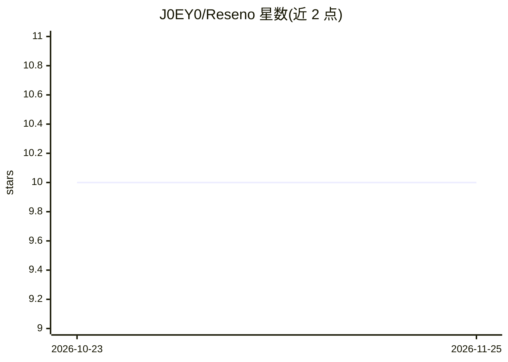

# J0EY0/Reseno

⭐ 10 · Python · MIT · 推送 2026-11-13 · [GitHub](https://github.com/J0EY0/Reseno) · 个人维护 · 中文 README

**自托管简历工作台：AI 以提案方式撰写与定制简历**

自托管的简历编辑工作台，前端 React 19/TypeScript，后端 FastAPI（Python 3.12+）。核心机制是 AI 按提案（proposal）编辑：Agent 生成结构化编辑草稿，用户逐条审阅后选择应用，网络中断后可重连。功能覆盖结构化编辑器、6 套内置模板与自定义模板、A4 实时预览、自动保存与版本历史、回收站、PDF/PNG/ZIP 导出，浏览器内解析 PDF。Agent 支持附件与公开网页搜索，模型在 Models 页配置，可接云服务商、本地运行时或自定义 API。

## 筛选速览

| 维度 | 判定 | 备注 |
|---|---|---|
| AI 角色 | `ai-native` | 本体是模型或模型工具 |
| 许可风险 | `permissive` | MIT |
| 部署形态 | `self-host` | docker 或自建部署 |
| 模型依赖 | — | README 未给出锁定关系 |
| 硬件要求 | — | 无带数字的原话,不猜 |
| 安装摩擦 | `low` | 无编译、无系统依赖或容器化 |
| 成熟度 | — | 结构信号不足 |

## 能力要点

- AI 编辑以提案草稿呈现，逐条审阅后应用，不做直接覆盖
- Agent 支持附件、公开网页搜索与断线重连
- 6 套内置模板加自定义模板，A4 分页实时预览与单页适配
- MIT 许可，Docker 镜像支持 Linux AMD64/ARM64

## 适用场景

- 本地自托管一个私密简历编辑工作台
- 让 AI 起草修改建议并逐条确认后再改简历
- 针对不同职位定制简历并导出 PDF/PNG

## 场景标签

`AI 写作` · 领域:内容生成

## 证据(README 行号)

> L12: Reseno is a self-hosted resume workspace where the AI edits by proposal, never by overwrite.
> L26: - AI agent with attachments, public web search, structured edit drafts and
> L104: To use the AI agent, add a model configuration on the Models page. You can

## 星数曲线

2026-10-23 10 → 2026-11-25 10（+0）

---
*卡片 v1 · prompt 1.4 · 生成 2026-11-20 · 置信度 mid · 依据 README sha `755c52858ae7` · [字段定义](../../DATASET.md)*
