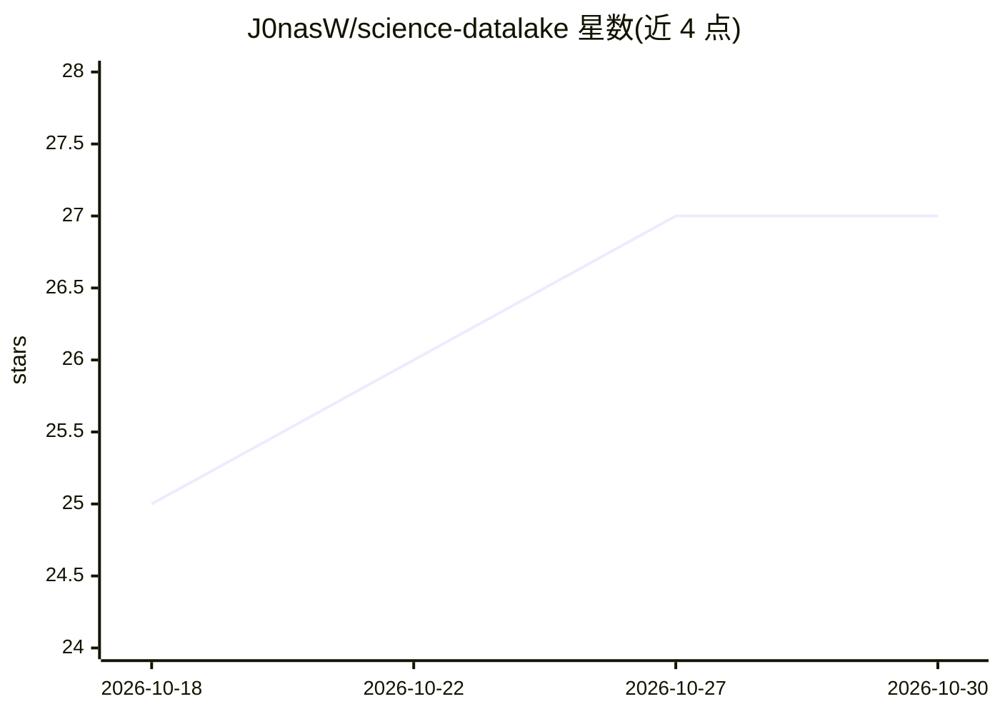

# J0nasW/science-datalake

⭐ 27 · Jupyter Notebook · NOASSERTION · 推送 2026-04-11 · [GitHub](https://github.com/J0nasW/science-datalake) · [官网](https://j0nasw.github.io/science-datalake/) · 个人维护

**2.93亿篇科学文献的统一数据湖，DuckDB 单接口可查**

将八个学术数据集（S2AG、SciSciNet、OpenAlex、Papers With Code 等）、13 个科学本体（130 万术语）与 1,320 万篇全文统一到单一 DuckDB 接口下，数据以约 1.3TB Parquet 文件存储、视图定义独立于数据从而可移植。提供 DOI 归一化（xref.doi_map，5.88 亿行）与预构建跨源表（unified_papers 2.93 亿行），并含幂等的快照更新流水线。面向科研人员与分析者，另配 SCHEMA.md 供 LLM 编码代理直接生成跨库 SQL 查询；需 Python 3.12+ 与足量 SSD 存储。

## 筛选速览

| 维度 | 判定 | 备注 |
|---|---|---|
| AI 角色 | `ai-knowledge` | 知识聚合/清单类 |
| 许可风险 | `permissive` | NOASSERTION |
| 部署形态 | `library` | 以包/库形式分发 |
| 模型依赖 | — | README 未给出锁定关系 |
| 硬件要求 | — | 无带数字的原话,不猜 |
| 安装摩擦 | `low` | 无编译、无系统依赖或容器化 |
| 成熟度 | — | 结构信号不足 |

## 能力要点

- 8 数据集 + 13 本体统一在 DuckDB 视图下（159 视图、20+ schema）
- DOI 归一化视图 xref.doi_map（5.88 亿行）实现跨数据集关联
- SCHEMA.md 面向 LLM 编码代理，含 join 策略与 SQL 示例
- 幂等更新流水线可刷新各数据源快照

## 适用场景

- 跨 S2AG/OpenAlex/SciSciNet 做引文网络与学科计量分析
- 通过 AI 编码代理用自然语言生成跨库查询
- 利用本体术语表做生物医学术语与主题映射

## 场景标签

`科研工具` · 领域:学习与行业

## 证据(README 行号)

> L12: Portable data lake of 480M+ scientific publications from eight complementary datasets, 13 scientific ontologies (1.
> L18: Eight scholarly datasets, 13 scientific ontologies, and a unified full-text corpus under a single DuckDB interface 
> L161: This data lake is designed to be queryable by LLM-based coding agents (Claude Code, Cursor, Copilot, etc.). The ke

## 星数曲线

2026-10-18 25 → 2026-10-30 27（+2）

---
*卡片 v1 · prompt 1.4 · 生成 2026-10-26 · 置信度 mid · 依据 README sha `aaa4a37a66f0` · [字段定义](../../DATASET.md)*
