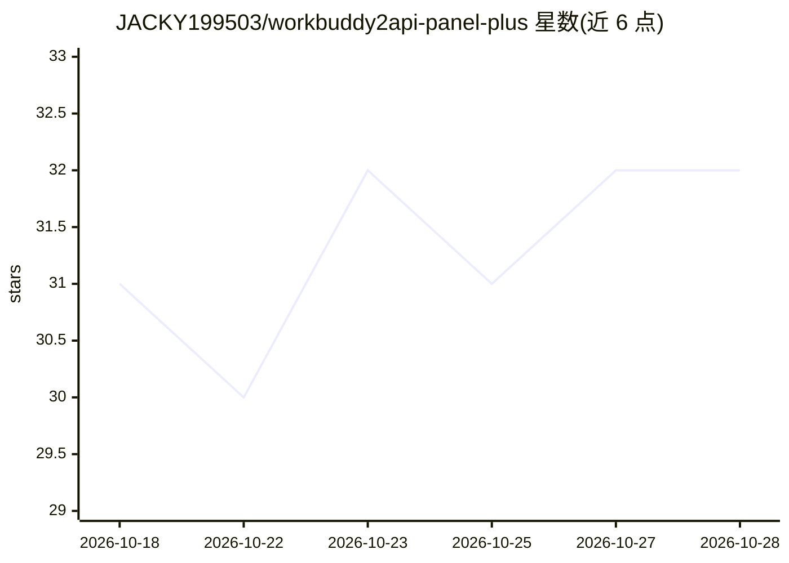

# JACKY199503/workbuddy2api-panel-plus

⭐ 32 · Go · MIT · 推送 2026-10-16 · [GitHub](https://github.com/JACKY199503/workbuddy2api-panel-plus) · [官网](https://github.com/JACKY199503/workbuddy2api-panel-plus) · 个人维护 · 中文 README

**把 CodeBuddy 账号变成 OpenAI 兼容 API 的多账号网关增强版**

基于 linguo2625469/workbuddy2api-panel 的二次开发仓库：在保留上游账号池调度、冷却熔断、Web 面板等功能之上，新增三项能力——API 子密钥分发（按额度、有效期、IP/模型白名单签发 wbk_ 钥匙）、按北京时间昼夜自动选模型的编排引擎（含降级链，链尾兜底）、以及 /v1/chat/completions、/v1/responses、/v1/messages 三协议接入（兼容 OpenAI SDK、Codex、Claude Code 等）。Go 编写，Docker Compose 一键部署，面板端口 7863。README 明确声明密钥分发仅限自用，禁止商用转售与对外分发。

## 筛选速览

| 维度 | 判定 | 备注 |
|---|---|---|
| AI 角色 | `ai-ecosystem` | LLM/agent 周边工具 |
| 许可风险 | `permissive` | MIT |
| 部署形态 | `self-host` | docker 或自建部署 |
| 模型依赖 | — | README 未给出锁定关系 |
| 硬件要求 | — | 无带数字的原话,不猜 |
| 安装摩擦 | `low` | 无编译、无系统依赖或容器化 |
| 成熟度 | — | 结构信号不足 |

## 能力要点

- 签发带额度/IP白名单/模型白名单/有效期的 wbk_ 子密钥，服务端只存摘要
- 模型编排：请求传 auto 时按北京时间昼夜自动选主模型，限流/耗尽时沿降级链切换，链尾兜底
- 三种协议端点（chat/completions、responses、messages）共用同一账号池、子钥匙与编排
- clone 即完整网关+面板，无需先装上游或打补丁

## 适用场景

- 给自己的多个项目、多台机器分别配 API 钥匙并限制额度
- 让 Claude Code / Codex / OpenAI 客户端直连 CodeBuddy 账号池
- 自动切换模型把每日免费额度用满，减少手动改配置

## 场景标签

`模型网关` · 领域:Agent 开发

## 证据(README 行号)

> L5:  把腾讯 CodeBuddy 账号变成 OpenAI 兼容 API 的多账号网关 · 附 Web 管理面板
> L15: 上游是 linguo2625469/workbuddy2api-panel —— CodeBuddy 多账号网关 + Web 面板。本仓库**上游功能一个没动**，只在其上加了三项：API 密钥分发、模型编排、多协议接入。

## 星数曲线

2026-10-18 31 → 2026-10-28 32（+1）

---
*卡片 v1 · prompt 1.4 · 生成 2026-10-26 · 置信度 mid · 依据 README sha `3362f312680a` · [字段定义](../../DATASET.md)*
