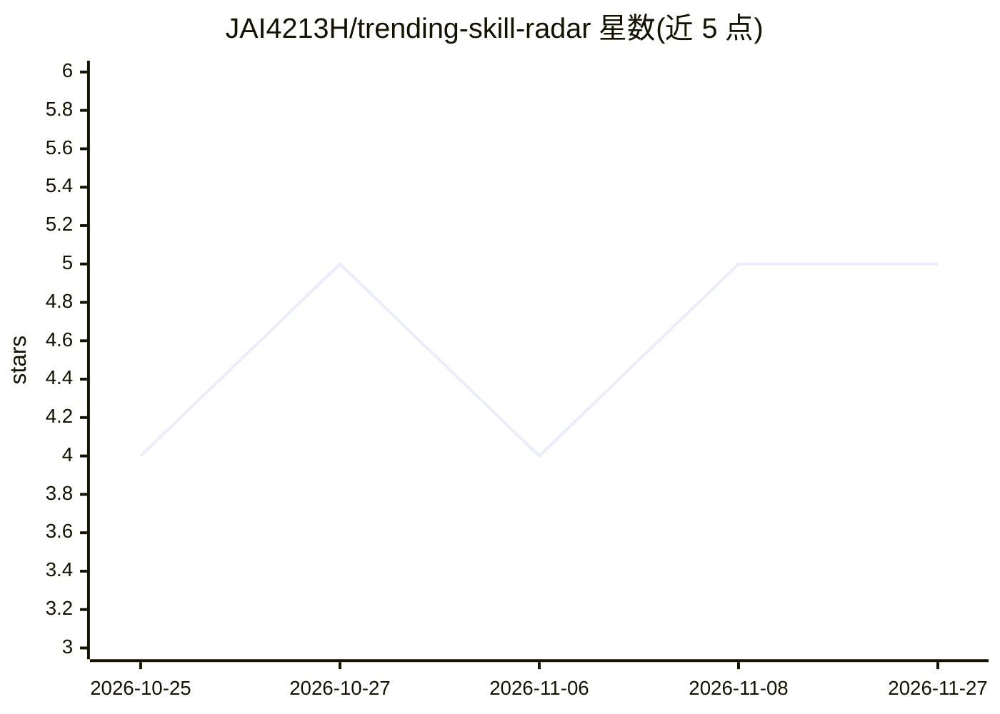

# JAI4213H/trending-skill-radar

⭐ 5 · Python · MIT · 推送 2026-10-13 · [GitHub](https://github.com/JAI4213H/trending-skill-radar) · 个人维护

**AI/ML/LLM 领域技能趋势证据排名与学习路径工具**

以证据驱动方式对 AI、ML、LLM 工程领域的可学习技能做趋势排名：区分标题热度与实际能力，输出全球趋势排名、个人学习排名、证据覆盖与反证信息，缺证据时标注 Insufficient Evidence 而非猜测。核心管线离线运行、无需付费模型，评分为确定性且带版本；可选 JSON 收集器接入 OpenAlex 与 GitHub REST API，就业市场数据在无授权来源时显示 Unavailable。提供 Codex skill 入口与平台中立的 CLI。

## 筛选速览

| 维度 | 判定 | 备注 |
|---|---|---|
| AI 角色 | `ai-native` | 本体是模型或模型工具 |
| 许可风险 | `permissive` | MIT |
| 部署形态 | `None` |  |
| 模型依赖 | — | README 未给出锁定关系 |
| 硬件要求 | — | 无带数字的原话,不猜 |
| 安装摩擦 | `low` | 无编译、无系统依赖或容器化 |
| 成熟度 | — | 结构信号不足 |

## 能力要点

- 全球趋势排名与个人学习排名双视角输出
- 分数确定性、带版本，缺证据标注而非填充猜测
- 离线运行无需付费模型，可选接入 OpenAlex/GitHub API
- 平台中立：SKILL.md/PORTABLE_PROMPT.md/CLI 多入口

## 适用场景

- 决定下一步学什么 AI/ML 技能并查看支撑证据
- 对比技能的趋势强度、当前价值与未来潜力
- 为某领域生成具体到工具链与可验证成果的学习建议

## 场景标签

`科研工具` · 领域:学习与行业

## 证据(README 行号)

> L7: An evidence-driven radar for deciding what to learn next in AI, ML, and LLM engineering.
> L65: Scores are deterministic and versioned. Missing evidence is reported as **Insufficient Evidence**—never filled with
> L82: - **Codex:** use `/trending-skill-radar` or load `SKILL.md`

## 星数曲线

2026-10-25 4 → 2026-11-27 5（+1）

---
*卡片 v1 · prompt 1.4 · 生成 2026-11-21 · 置信度 high · 依据 README sha `ab7fddaeffb6` · [字段定义](../../DATASET.md)*
